# IYAE

AI-powered fashion marketplace combining conversational AI styling, 3D/AR virtual try-on, and an independent designer marketplace. Targets Gen Z and young millennial shoppers (18-30) to eliminate decision fatigue and reduce fashion returns.

## Project Vision

Help shoppers go from "I have nothing to wear" to "I feel great about this look" through AI-guided styling, 3D visualization, and a curated indie designer marketplace -- with near-zero returns.

## Architecture Overview

Four-service architecture orchestrated via Docker Compose, sharing a MySQL 8 database. Production adds Nginx reverse proxy + Certbot SSL.

```
Next.js 16 (web :3000)  ---REST/JSON + JWT--->  Spring Boot 3.4 (server :8080)  ---JDBC--->  MySQL 8 (:3306)
                                                         |
                                                 Shared MySQL tables
                                             (model_generation_tasks,
                                              avatar_generation_tasks,
                                              rigging_tasks)
                                                         |
                                                 Python 3.12 (worker)
                                           3D model + avatar + rigging generation

Resend (transactional email) <--- Next.js web (/api/internal/mail/send) <--- server (HTTP POST)
```

The `rigging-worker` service (optional, enabled via `--profile rigging`) runs the garment rigging pipeline as a separate container using `Dockerfile.rigging`.

## Module Structure

```mermaid
graph TD
    A["IYAE"] --> B["server"]
    A --> C["web"]
    A --> D["worker"]
    A --> E["nginx"]

    B --> B1["controller (27)"]
    B --> B2["service (34)"]
    B --> B3["entity (29 + 17 enums)"]
    B --> B4["ai (7: interface + factory + exception + 4 impls)"]
    B --> B5["security (JWT + RateLimitFilter)"]
    B --> B6["config (10, incl. BrandProperties)"]
    B --> B7["db/migration (Flyway, 26 files)"]
    B --> B8["test (79 test classes, 730 methods + 3 test support)"]
    B --> B9["util (GlbPlaceholderGenerator)"]

    C --> C1["app/ (37 page routes + 1 internal API route + error boundaries)"]
    C --> C2["components/ (78 app: 76 .tsx + 2 .ts, + 16 shadcn/ui)"]
    C --> C3["lib/ (api, auth, cart, 16 hooks, 14 domain modules incl. brand.ts)"]
    C --> C4["__tests__/ (vitest, 54 test files, 597 cases)"]
    C --> C5["e2e/ (Playwright, 10 spec files, 118 tests)"]

    D --> D1["task_queue + avatar_task_queue + rigging_task_queue (3 queues)"]
    D --> D2["providers (stub, tripo3d, meshy, smplx, smplx_stub, 3 rigging, skeleton, preflight, weight_transfer, glb_writer, a_pose, scale_normalizer)"]
    D --> D3["validator (GLB header, triangle count, bbox, NaN, rigged GLB)"]
    D --> D4["tests (19 test files, 404 passed + 10 skipped)"]

    E --> E1["nginx.conf"]
    E --> E2["conf.d/default.conf"]

    click B "./server/CLAUDE.md" "Server module docs"
    click C "./web/CLAUDE.md" "Web module docs"
    click D "./worker/CLAUDE.md" "Worker module docs"
```



## Module Index

| Module | Language | Purpose | Entry Point |
|--------|----------|---------|-------------|
| [server](./server/CLAUDE.md) | Java 22 / Spring Boot 3.4 | REST API, business logic, auth (email verification + password reset + multi-step registration with profile/preference/measurement fields + public profiles), AI chat, outfit generation, 3D model orchestration, garment rigging orchestration, community posts/follows, Stripe checkout, rate limiting, Resend-only email delivery (POSTs to the Next.js internal mail route; no SMTP), guest avatar generation, cloth size selection | `IyaeApplication.java` |
| [web](./web/CLAUDE.md) | TypeScript / Next.js 16 | Frontend SPA (all CSR), 37 page routes + 1 internal API route, 3D/AR viewers with pose animation, CSP middleware, community feed, user profiles, multi-step registration wizard, manual outfit builder, AI chat suggestion chips, designer studio/promotions, Resend email templates, cloth size selector, E2E tests | `app/layout.tsx` |
| [worker](./worker/CLAUDE.md) | Python 3.12 | 3D model + avatar generation daemon (polls MySQL task queues, validates GLB metadata, retries failed tasks, reclaims stale tasks, SMPL-X avatar generation, garment rigging (weight transfer)) | `main.py` |
| nginx | Config only | Reverse proxy (production), SSL termination, static asset serving | `nginx/conf.d/default.conf` |

## Running & Development

### Prerequisites

- Docker + Docker Compose
- Java 22 (for server local dev)
- Node.js (for web local dev)
- Python 3.12 (for worker local dev)

### Quick Start (Docker)

```bash
./dev.sh setup                 # First-time: check prereqs, generate .env, create JWT_SECRET
./dev.sh start                 # Start all services (MySQL + Server + Worker + Web)
./dev.sh status                # Show container states and health checks
./dev.sh web                   # Run frontend on host with hot reload (alternative to container)
```

#### Dev Port Mappings

Docker Compose maps host ports to avoid conflicts with local services:

| Service | Host Port | Container Port | Health Check URL |
|---------|-----------|----------------|------------------|
| Web (Frontend) | `${WEB_PORT:-3000}` | 3000 | `http://localhost:3000` |
| Server (API) | `${API_PORT:-3001}` | 8080 | `http://localhost:3001/api/health` |
| MySQL | `${DB_PORT:-3002}` | 3306 | -- |

### dev.sh Commands

| Command | Description |
|---------|-------------|
| `setup` | Check prerequisites (docker, curl), generate `.env` from `.env.example`, auto-create JWT_SECRET |
| `start` | `docker compose up -d` + wait for MySQL healthy + API health check |
| `stop` | Stop all services |
| `status` | Show container status, curl health endpoints |
| `logs [service]` | Tail logs (all or specific service) |
| `build [service]` | Rebuild containers (all or specific) |
| `restart [service]` | Rebuild and restart services (all or specific) |
| `reset` | Stop services and wipe all data volumes |
| `db backup` | Dump database to timestamped SQL file |
| `db restore <file>` | Restore database from SQL file (with confirmation) |
| `web` | Run `npm run dev` in web/ directory (host-mode hot reload) |

### Local Development (without Docker)

```bash
# Server (requires MySQL on :3306)
cd server && ./gradlew bootRun

# Web (proxies /api/* to $API_PROXY_TARGET, default localhost:3001 via next.config.ts rewrites)
cd web && npm install && npm run dev

# Worker (requires MySQL on :3306)
cd worker && pip install -r requirements.txt && python main.py
```

### Production Deployment

> **`prod_deploy.sh` / `docker-compose.prod.yml` are NOT the live deployment path.** The
> instance runs on a shared multi-app VPS, provisioned from a separate infrastructure repo that
> clones this one and uses `web/`, `server/` and `worker/` only as Docker build contexts. That
> repo owns the compose file, the generated `.env`, Traefik and TLS. Nothing there references
> anything in this section — verified by grep in both directions — and this stack cannot run
> there anyway: it binds 80/443 (Traefik's), declares no `proxy` network, and names the database
> `iyae` where the live one is `clossette`.
>
> Consequences worth knowing before changing deployment-adjacent code:
> - **`require_production_config` does not run in production.** Every preflight added to it —
>   TLS, Stripe pairing, mail (B-10) — guards a path nobody takes. The real path has no
>   equivalent of `require_env_vars` at all; required variables are enforced there with
>   `${VAR:?message}` in the infrastructure repo's compose file, and a new one has to be added
>   in *both* places to actually bite.
> - Treat `require_production_config` as the authoritative **specification** of what this app
>   needs to boot correctly. It is the best such inventory in the repository; it is just not a
>   gate on the live deploy.
> - The live host's health gate checks a 200 on the site root, not `/api/health/ready`, so it
>   stays green with the database down.


```bash
./prod_deploy.sh setup              # Check prereqs, generate .env, validate required vars
./prod_deploy.sh up                 # Build and start all production services
./prod_deploy.sh health             # Diagnostics: container status, HTTP checks, SSL expiry
./prod_deploy.sh update             # git pull + rebuild + restart
./prod_deploy.sh ssl-init <domain>  # Obtain SSL certificate via Let's Encrypt
./prod_deploy.sh ssl-renew          # Renew SSL certificates
./prod_deploy.sh logs [service]     # Tail production logs
./prod_deploy.sh stop               # Stop all production services
```

Production uses `docker-compose.prod.yml` with Nginx reverse proxy (ports 80/443), no services expose ports directly. All traffic routes through Nginx:
- `/api/*` -> Spring Boot server
- `/uploads/*`, `/assets/*` -> shared volume (static files)
- `/_next/static` -> Next.js with 1-year cache
- `/` -> Next.js web frontend

Nginx adds security headers: `X-Content-Type-Options: nosniff`, `X-Frame-Options: SAMEORIGIN`, `Referrer-Policy: strict-origin-when-cross-origin`. HTTPS server block is present but commented out (enable after `ssl-init`).

### Key Environment Variables

| Variable | Required | Default | Purpose |
|----------|----------|---------|---------|
| `MYSQL_ROOT_PASSWORD` | Yes | -- | MySQL root password |
| `DB_PASSWORD` | Yes | -- | App database user password |
| `JWT_SECRET` | Yes | -- | >=32 chars for HS256 signing |
| `SPRING_PROFILES_ACTIVE` | No | `dev` | Spring profile (dev/prod) |
| `AI_PROVIDER` | No | `mock` | `mock` / `claude` / `deepseek` / `minimax` |
| `ANTHROPIC_API_KEY` | When claude | -- | Claude API key |
| `DEEPSEEK_API_KEY` | When deepseek | -- | DeepSeek API key |
| `MINIMAX_API_KEY` | When minimax | -- | MiniMax API key |
| `CORS_ORIGINS` | No | `http://localhost:3000,http://localhost:3001,http://iyae.localhost` | Allowed CORS origins |
| `API_PROXY_TARGET` | No | `http://localhost:3001` | Next.js API proxy (runtime for local dev, build-time arg in container) |
| `WEB_PORT` | No | `3000` | Host port for web frontend |
| `API_PORT` | No | `3001` | Host port for API server |
| `DB_PORT` | No | `3002` | Host port for MySQL |
| `WEB_DOMAIN` | No | `iyae.localhost` | Traefik domain for web |
| `API_DOMAIN` | No | `api.iyae.localhost` | Traefik domain for API |
| `NEXT_PUBLIC_API_URL` | No | `""` | Frontend API base URL (production) |
| `MODEL_GENERATION_PROVIDER` | No | `mock` | `mock` / `tripo3d` / `meshy` |
| `WORKER_TRIPO_API_KEY` | For tripo3d | -- | Tripo3D API key |
| `WORKER_MESHY_API_KEY` | For meshy | -- | Meshy.ai API key |
| `WORKER_MESHY_ENABLE_PBR` | No | `false` | Enable Meshy PBR maps (metallic/roughness/normal); off by default (extra credits) — drape-realism Phase 2 C1 |
| `WORKER_POLL_INTERVAL` | No | `5` | Seconds between task queue polls |
| `WORKER_OUTPUT_DIR` | No | `/var/iyae/assets` | Directory for generated 3D model output |
| `FRONTEND_BASE_URL` | No | `http://localhost:3000` | Base URL for email links (verification, password reset) |
| `WEATHER_ENABLED` | No | `true` | Enable live weather context for the AI stylist |
| `WEATHER_API_URL` | No | `https://api.open-meteo.com/v1/forecast` | Open-Meteo forecast endpoint (keyless) |
| `WEATHER_LATITUDE` | No | `43.6532` | Latitude for weather lookup (default Toronto) |
| `WEATHER_LONGITUDE` | No | `-79.3832` | Longitude for weather lookup (default Toronto) |
| `WEATHER_TIMEZONE` | No | `America/Toronto` | Timezone for weather lookup |
| `WEATHER_CACHE_TTL` | No | `1800` | Weather cache TTL in seconds; also the off-path cache pre-warm cadence |
| `ANALYTICS_DRAPE_DEPLOY_CUTOFF` | No | `` (empty) | ISO-8601 instant of the Phase 1-3 drape deploy; default split point for `GET /api/admin/kpis/drape-decision` pre/post comparison — drape-realism Phase 4. Empty → endpoint requires `?cutoff=` |
| `AVATAR_GENERATION_PROVIDER` | No | `mock` | `mock` / `smplx` (avatar body model provider) |
| `SMPLX_MODELS_PATH` | For smplx | `./smplx_models` | Host path to SMPL-X model files (mounted read-only into worker container) |
| `RIGGING_PROVIDER` | No | `mock` | `mock` / `python` / `blender` (garment rigging provider) |
| `BLENDER_PATH` | For blender | `blender` | Path to Blender executable (only when RIGGING_PROVIDER=blender) |
| `JAVA_TOOL_OPTIONS` | No | `-Xmx384m -Xms128m` | JVM memory tuning (dev docker-compose only) |
| `RESEND_API_KEY` | No | -- | Resend API key for transactional email delivery (web container) |
| `RESEND_MAIL_ENDPOINT` | No | -- | URL of the Next.js internal mail route the server POSTs to (dev docker: `http://web:3000/api/internal/mail/send`) |
| `INTERNAL_MAIL_SECRET` | No | `dev-internal-secret` | Shared secret for server->web internal mail API calls |
| `RESEND_FROM_EMAIL` | No | `onboarding@resend.dev` | Resend sender email address (use verified domain in production) |

## Test Strategy

| Module | Framework | Tests Present | Test Files | Coverage |
|--------|-----------|---------------|------------|----------|
| server | JUnit 5 + Mockito + MockMvc | Yes | 77 test classes (683 test methods + 4 test support) | Comprehensive (24 service tests + 20 controller tests + 4 other: auth, cart w/ size selection, JWT, health, generation, product, GLB util, secure token, rate limit, email (Resend-only), rigging, chat w/ suggestions, body profile, saved looks, reviews, outfits, avatar, checkout w/ Stripe, promotions, orders, posts, follows, designer profile, file storage, garment asset, user, model orchestration; all controllers WebMvcTest with security config) |
| web | Vitest + Testing Library + jsdom | Yes | 54 files (597 test cases) | Partial (API client, AuthContext, CartContext w/ size, community feed, profile surface, profile dashboard, middleware CSP, useDebounce, useRequireAuth, useGenerationStatus, useRedirectIfAuthenticated, FittingHelper, SizeSelector, useOutfitRiggingStatus, useCommunityState, useRiggingStatus, pose-config, internal mail send route, verify-email + verify-email/pending pages, products page request races, admin moderation console, community feed, public profile page, token contrast guard incl. the full dark palette, dark-mode token plumbing compiled from globals.css) |
| web (E2E) | Playwright | Yes | 10 specs (118 tests) | Moderate (auth flows, registration wizard, pose selector, AI stylist, cart w/ size, checkout flow, community, designer CRUD) |
| worker | pytest | Yes | 19 files (404 passed, 10 skipped) | Partial (task_queue claim/retry/reclaim, validator GLB/USDZ/metadata/bbox/NaN/rigged-GLB/skin/bones, StubGenerator output/payload/integration, MeshyGenerator init/generate/errors/payload/image-url-resolve, AvatarTaskQueue claim/complete/fail/reclaim, SmplxProvider generate/measurements/errors/stub/gender/LFS/caching, RiggingTaskQueue claim/complete/fail/reclaim, PythonRiggingProvider validation/output/call-chain/scale-normalization, BlenderRiggingProvider, weight transfer surface-match/inpainting/prune-normalize, mesh preflight/garment-size-warnings, skinned GLB writer/joint-hierarchy/positioning, A-pose vector, scale normalizer, pose GLB generation) |

```bash
cd server && ./gradlew test            # Server (JUnit 5, mocked repos)
cd web && npm run test                 # Web (Vitest, jsdom)
cd web && npm run test:watch           # Web (Vitest, watch mode)
cd web && npm run test:e2e             # Web (Playwright, requires running dev server + API)
cd worker && pytest                    # Worker (unit tests)
```

### Server Test Details

**Service Tests (24 files, 213 methods):**

| Test File | Tests | Covers |
|-----------|-------|--------|
| `AuthServiceTest` | 19 | Register (success/duplicate-email/with-measurements/duplicate-username/designer-role/buyer-role), login, updateProfile, verifyEmail, forgotPassword, resetPassword |
| `CartServiceTest` | 11 | Cart CRUD + ownership + size selection |
| `ChatServiceTest` | 11 | AI provider fallback, suggestion extraction/stripping/truncation/fallback |
| `ProductServiceTest` | 22 | Catalog, categories, product detail, CRUD, ownership |
| `GenerationServiceTest` | 8 | Status, regenerate, ownership |
| `RiggingServiceTest` | 15 | requestRigging, getStatus, retry, processReadyTasks, materialize, supersede |
| `OutfitServiceTest` | 10 | Outfit generation + slot matching + manual builder |
| `SavedLookServiceTest` | 10 | Saved look CRUD + ownership |
| `ReviewServiceTest` | 9 | Review create/delete + ownership + summary |
| `BodyProfileServiceTest` | 6 | Body profile CRUD + ownership |
| `AvatarServiceTest` | 6 | Gender identity mapping for avatar payload |
| `AuthMailServiceTest` | 6 | Email sending via Resend POST to the Next.js internal route (verified with an in-process HttpServer) + EmailDeliveryException on failure |
| `SecureTokenServiceTest` | 5 | Token generation + SHA-256 hashing |
| `CheckoutServiceTest` | 14 | Stripe checkout (session creation, webhook handling, order fulfillment, size in line items) |
| `PostServiceTest` | 13 | Community post CRUD, feed, like, comment |
| `PromotionServiceTest` | 9 | Promotion CRUD + slot management |
| `FollowServiceTest` | 7 | Follow/unfollow toggle, list followers/following |
| `ModelGenerationOrchestrationServiceTest` | 6 | High-level generation orchestration |
| `OrderServiceTest` | 5 | Order history, detail, ownership |
| `UserServiceTest` | 5 | User account operations |
| `DesignerProfileServiceTest` | 5 | Designer profile management |
| `FileStorageServiceTest` | 5 | File upload (JPEG/PNG/WebP, atomic write) |
| `GarmentAssetServiceTest` | 4 | Garment asset retrieval |
| `HealthServiceTest` | 2 | Server and AI health probes |

**Controller Tests (20 files, 100 methods):**

| Test File | Tests | Covers |
|-----------|-------|--------|
| `AuthControllerTest` | 10 | Register, login, verify-email, forgot/reset-password, me, public profile |
| `PostControllerTest` | 8 | Post CRUD, feed, like, comment endpoints |
| `CartControllerTest` | 7 | Cart CRUD endpoints + size selection |
| `PromotionControllerTest` | 6 | Promotion management endpoints |
| `ProductControllerTest` | 5 | Catalog, category, detail endpoints |
| `DesignerProductControllerTest` | 5 | Designer product CRUD endpoints |
| `GenerationStatusControllerTest` | 5 | 3D generation status, regenerate, retry |
| `RiggingControllerTest` | 5 | Rigging trigger, status, retry |
| `ReviewControllerTest` | 5 | Product review endpoints |
| `FollowControllerTest` | 5 | Follow toggle, followers/following |
| `SavedLookControllerTest` | 5 | Saved look CRUD endpoints |
| `ChatControllerTest` | 5 | Chat session, message endpoints |
| `OutfitControllerTest` | 4 | Outfit generation, view endpoints |
| `AvatarControllerTest` | 4 | Avatar generation endpoint |
| `BodyProfileControllerTest` | 4 | Body profile endpoints |
| `CheckoutControllerTest` | 4 | Checkout endpoint |
| `DesignerUploadControllerTest` | 4 | Image upload endpoint |
| `HealthControllerTest` | 3 | Health + AI health (WebMvcTest) |
| `OrderControllerTest` | 3 | Order history endpoints |
| `StripeWebhookControllerTest` | 3 | Stripe webhook handling |

**Other Tests (4 files, 23 methods):**

| Test File | Tests | Covers |
|-----------|-------|--------|
| `RateLimitFilterTest` | 10 | Per-IP rate limiting + XFF proxy support |
| `JwtTokenProviderTest` | 7 | Token generate/validate/extract |
| `GlbPlaceholderGeneratorTest` | 5 | GLB generation, file writing, directory creation |
| `IyaeApplicationTests` | 1 | Application context load |

**Test Support (3 files):** `TestUsers`, `TestProducts`, `WebMvcSecurityConfig`

### Web Test Details

| Test File | Tests | Covers |
|-----------|-------|--------|
| `__tests__/lib/api.test.ts` | 12 | API client (GET/POST/PUT/DELETE, JWT injection, error handling, auth helpers, type structure) |
| `__tests__/lib/auth-context.test.tsx` | 12 | AuthContext (initial state, login, register with full profile, logout, refreshUser) |
| `__tests__/components/SizeSelector.test.tsx` | 5 | SizeSelector (renders sizes, selection state, disabled state, aria-pressed, empty sizes) |
| `__tests__/lib/cart-context.test.tsx` | 10 | CartContext (demo items CRUD w/ size, totalCount, server items fetch/404) |
| `__tests__/lib/community-feed.test.ts` | 65 | Community feed (toggleLike/Save/Repost, comments/replies, delete lifecycle, tab filtering, follows, create/archive/restore) |
| `__tests__/lib/profile-surface.test.ts` | 10 | Profile surface (cross-tab sync, localStorage persistence, avatar/banner/bio state) |
| `__tests__/lib/profile-dashboard.test.ts` | 16 | Profile dashboard (tab filtering, stats calculation, body measurement coverage) |
| `__tests__/middleware.test.ts` | 10 | Middleware CSP headers (script-src env-aware, X-Frame-Options, Permissions-Policy) |
| `__tests__/lib/hooks/useDebounce.test.ts` | 7 | useDebounce hook (delay, value updates, cleanup) |
| `__tests__/lib/hooks/useRequireAuth.test.ts` | 7 | useRequireAuth hook (redirect unauthenticated, role check, allow authenticated) |
| `__tests__/lib/hooks/useGenerationStatus.test.ts` | 11 | useGenerationStatus hook (polling, status transitions, error handling) |
| `__tests__/lib/hooks/useRedirectIfAuthenticated.test.ts` | 6 | useRedirectIfAuthenticated hook (redirect authenticated users away from auth pages) |
| `__tests__/components/FittingHelper.test.ts` | 13 | FittingHelper (LAYER_MAP constants, material offset, scene traversal) |
| `__tests__/lib/hooks/useOutfitRiggingStatus.test.ts` | 13 | useOutfitRiggingStatus hook (polling lifecycle, rigging status sync, AbortController) |
| `__tests__/lib/pose-config.test.ts` | 14 | pose-config (manifest-driven presets, categories, getPoseById, animated pose fields) |
| `__tests__/api/internal-mail-send.test.ts` | 11 | Internal mail send API route (auth secret validation, Resend integration, error handling) |

### E2E Test Details

| Spec File | Tests | Covers |
|-----------|-------|--------|
| `e2e/auth.spec.ts` | 6 | Login + dashboard redirect, register form, products without auth, invalid credentials, link navigation |
| `e2e/register-wizard.spec.ts` | 10 | Wizard step navigation, validation, Complete Later, full flow, duplicate email |
| `e2e/pose-selector.spec.ts` | 5 | Pose strip rendering, active state, category filtering, animation trigger |
| `e2e/ai-stylist.spec.ts` | 6 | AI stylist chat interaction, suggestion chips, floating widget |
| `e2e/cart.spec.ts` | 10 | Cart add/remove/update, demo items, quantity limits, checkout link |
| `e2e/checkout-flow.spec.ts` | 8 | Checkout flow, order creation, success/cancel pages |
| `e2e/community.spec.ts` | 8 | Community feed, post interaction, likes, comments, profile navigation |
| `e2e/designer-crud.spec.ts` | 7 | Designer product create/edit/delete, image upload, 3D generation |

### Worker Test Details

| Test File | Tests | Covers |
|-----------|-------|--------|
| `test_task_queue.py` | 7 | TaskQueue (claim returns None/dict, retry under limit/refuses/exception, reclaim stale/none) |
| `test_validator.py` | 37 | Validator (GLB header 4, USDZ 2, triangle count 5, bbox 6, NaN 5, metadata 5, rigged GLB 2, skin metadata 5, required bones 3) |
| `test_stub_generator.py` | 13 | StubGenerator (create_minimal_glb 4, generate output 4, payload schema 3, validator integration 2) |
| `test_meshy_generator.py` | 30 | MeshyGenerator (image URL resolve 6, init 5, generate flow 4, errors 5, payload schema 10) |
| `test_avatar_task_queue.py` | 4 | AvatarTaskQueue (claim/complete/fail/reclaim) |
| `test_smplx_provider.py` | 54 | SmplxProvider + SmplxStubProvider (generate, measurements, errors, GLB output, gender handling, LFS file detection, model caching, skin metadata) |
| `test_rigging_task_queue.py` | 8 | RiggingTaskQueue (claim/complete/fail/reclaim, max attempts) |
| `test_python_rigging_provider.py` | 19 | PythonRiggingProvider (validation, path resolve, output format, call chain, SMPL-X path, scale normalization integration) |
| `test_weight_transfer.py` | 18 | Weight transfer (phase 1 surface match, phase 2 inpainting, phase 3 prune/normalize, pipeline, dense_weights_to_top4) |
| `test_mesh_preflight.py` | 9 | Mesh preflight (valid mesh, degenerate faces, loose vertices, non-manifold edges, garment size warnings above/below/at threshold, normal ratio) |
| `test_skinned_glb_writer.py` | 17 | Skinned GLB writer (joint hierarchy, inverse bind matrices, round-trip GLB/skin/bones, buffer alignment, shape validation, child joint positioning) |
| `test_blender_rigging_provider.py` | 46 | BlenderRiggingProvider (subprocess invocation, script generation, error handling, timeout, output parsing, fallback behavior) |
| `test_a_pose.py` | 5 | A-pose vector (63 floats, shoulder values, only shoulders nonzero, immutability) |
| `test_scale_normalizer.py` | 15 | Scale normalizer (bbox computation, slot ratios TOP/BOTTOM/DRESS, centering, immutability, edge cases) |
| `test_generate_pose_glbs.py` | 10 | Pose GLB generation (manifest-driven config, GLB output, skeleton structure) |

## Coding Conventions

- **Server (Java)**: Lombok annotations (`@RequiredArgsConstructor`, `@Slf4j`, `@Builder`), Jakarta Bean Validation (`@Valid`) at controller layer, ownership checks in service layer, records for DTOs, `GlobalExceptionHandler` maps exceptions to HTTP status codes (400 for IllegalArgumentException, 403 for AccessDeniedException, 503 for AIProviderException and EmailDeliveryException), `@Max(100)` on cart item quantities, brand-derived server values (health service id, guest sentinel email, seed-email domain) bound from `app.brand.*` via the `BrandProperties` `@ConfigurationProperties` record; transactional email is Resend-only -- `AuthMailService` POSTs to the Next.js internal mail route (no JavaMailSender/SMTP)
- **Web (TypeScript)**: All pages `"use client"` (no RSC), shadcn/ui primitives in `components/ui/` (CLI-generated, do not edit by hand), `api.ts` wrapper for typed fetch with auto JWT injection, AbortSignal support, `auth` helper object (register/login/me/updateProfile), and `rigging` helper object (getStatus/trigger/retry), Suspense boundaries on pages using `useSearchParams`, CSP headers via `middleware.ts` with environment-aware `script-src` policy, community/profile data modules use immutable update patterns and localStorage persistence, all colors use semantic tokens (`bg-background`, `bg-card`, `text-foreground`, `text-muted-foreground`, `border-border`, `bg-muted`, `shadow-heavy`) for dark mode compatibility -- avoid hardcoded `stone-*` or `bg-white` classes, CSS gradient variables (`--gradient-page-*`, `--gradient-profile-banner-*`) with dark mode overrides in `globals.css`, all brand values (wordmark, tagline, canonical URL, mail-from) sourced from `web/lib/brand.ts` (`BRAND`) rather than hardcoded per component
- **Worker (Python)**: Standard library + mysql-connector-python + requests; no ORM; connection-per-poll-cycle pattern; stale task reclamation every 12 poll cycles (approx. 1 minute); GLB metadata validation (triangle count, bounding box, NaN checks) in addition to header validation; rigging output uses schemaVersion=2 payload format (distinct from model generation schemaVersion=1); MeshyGenerator auto-converts local file paths to base64 data URIs via `_resolve_image_url()`
- **Database**: Flyway migrations only (Hibernate `ddl-auto: validate`); add tables via `V{N}__description.sql` in `server/src/main/resources/db/migration/`; 26 migrations (V1-V26)
- **Shared contract**: `model_generation_tasks`, `avatar_generation_tasks`, and `rigging_tasks` MySQL tables are the integration points between server and worker; `TaskStatus` enum includes `MATERIALIZED` (internal status mapped to `READY` in API responses)
- **Cart size selection**: `cart_items.selected_size` column (V10 migration); unique key `(cart_id, product_id, selected_size)` allows same product in different sizes

## AI Usage Guidelines

- `PRD.md` is the canonical product spec (epics, API contracts, data model, delivery phases)
- `web/AGENTS.md` warns that Next.js 16 has breaking changes -- always read `node_modules/next/dist/docs/` before changing Next.js APIs
- AI provider implementations follow the `AIProvider` interface at `server/.../ai/AIProvider.java` (includes `default healthCheck()` method)
- `AIProviderFactory` provides `getProviderName()` and `healthCheck()` for the `/api/health/ai` endpoint
- The `[GENERATE_OUTFIT]...[/GENERATE_OUTFIT]` protocol in `ChatService` bridges conversational AI and outfit generation
- Demo items use negative IDs -- do not confuse with real product IDs in the database
- Login returns 400 (not 401) on invalid credentials as a deliberate constant-time enumeration prevention measure
- `MATERIALIZED` is an internal task status -- the API externally maps it to `READY` (see `GenerationService.getStatus`)
- Forgot-password endpoint always returns 200 with a generic message to prevent account enumeration
- Community posts/follows are now server-persisted via `/api/posts` and `/api/follows` endpoints (V8 migration); client-side `community-feed.ts` and `social-graph.ts` still provide localStorage-based demo data for offline/unauth browsing

## Key Infrastructure Files

| Path | Purpose |
|------|---------|
| `PRD.md` | Canonical product specification |
| `.env.example` | Environment variable template (copy to `.env`) |
| `docker-compose.yml` | Dev orchestration (4 services: mysql, server, worker, web) |
| `docker-compose.prod.yml` | Production orchestration (6 services incl. nginx + certbot) |
| `dev.sh` | Development helper commands |
| `prod_deploy.sh` | Production deployment helper |
| `nginx/nginx.conf` | Nginx main config (gzip, client_max_body_size 20m) |
| `nginx/conf.d/default.conf` | Nginx routing rules (API proxy, static assets, WebSocket upgrade) |
| `worker/Dockerfile.rigging` | Rigging worker container (Python 3.12 + libigl + robust-laplacian) |
| `docs/CODEMAPS/` | Compact architecture maps (5 files: architecture, backend, frontend, data, dependencies) for quick AI context loading |
| `docs/api-reference/meshy_Image-to-3D.md` | Meshy.ai Image-to-3D API reference (endpoints, params, examples) |
| `docs/guides/GEN-Pose.md` | Pose generation guide (programmatic, FBX import, SMPL-X import) |
| `docs/huly/` | Huly knowledge base setup and Claude Cowork configuration (3 files) |
| `.gitignore` | Ignore rules for all modules |
| `.github/workflows/e2e.yml` | CI on every PR. Five parallel jobs: **Web** (`tsc --noEmit` + `eslint` + 561 vitest + `npm run build`), **Server** (683 JUnit against H2 — no database needed; uses `gradle/actions/setup-gradle` because `gradle-wrapper.jar` is gitignored), **Migrations** (applies V1–V26 to a MySQL 8 service container via `scripts/verify-migrations.sh`), **Worker** (404 pytest, CPU-only torch wheel), **Playwright** (brings the stack up via `docker compose`, waits for `DataSeeder`, then runs the `regression` and `audit` projects at different concurrency). Filename is historical — the workflow is named `CI` and is no longer E2E-only. |
| `scripts/verify-migrations.sh` | Applies every Flyway migration to a real MySQL 8, seeding the rows each data-dependent migration is supposed to process so it is exercised against data rather than against an empty database: duplicate listings before V23, NULL-provenance listings before V25. Also asserts the resulting constraints actually refuse what they are meant to (a duplicate unit, a NULL provenance, deleting an order a listing depends on). Runnable locally (starts its own throwaway container) and in CI. |

## Changelog

| Date | Action |
|------|--------|
| 2026-10-19 | **Dead-code sweep (`/ecc:refactor-clean`), verified per deletion.** Detection was `knip` + `eslint` on web, `vulture` on worker, and two scans written for this pass on server (zero-external-reference types, unused imports); every removal was followed by its module's full suite, and the suites were measured before the first change so a regression could not hide behind pre-existing drift — web 597/54 files, server 730/79 classes, both unchanged at the end, plus `tsc --noEmit` clean, `npm run build` green and eslint warnings 17 → 12. **Web:** `lib/hooks/useReveal.ts` and `components/home/motion-presets.ts` deleted outright (no importer anywhere); the three shadcn primitives nothing renders — `ui/alert`, `ui/avatar`, `ui/radio-group` — deleted with the two Radix packages that existed only for them (`@radix-ui/react-avatar`, `@radix-ui/react-radio-group`), after checking that the `Avatar` hits elsewhere are the unrelated 3D-avatar feature and that no `dynamic(() => import(...))` targets `components/ui`. `@types/dompurify` removed: dompurify 3.4.16 ships its own types through its exports map, so the stub was already shadowed. `postcss` **added** to devDependencies — `dark-mode-plumbing.test.ts` imports it directly and it was resolving only transitively, one dependency bump away from breaking. Symbol-level: 5 unreferenced `profile-options` constants, `statusBadgeClass` (and with it the file's last `cn` import), three `demo-looks` writers, `DEFAULT_FOLLOWED`, plus four exports demoted to module-private now that nothing imports them (`STATUS_TONE`, `SOCIAL_PROFILES`, `DEMO_CART_STORAGE_KEY`, `applyAntiPenetration`). The duplicate `uniqueEmail` in `register-wizard.spec.ts` — byte-identical to the one `seed-users.ts` already exports — now imports it; `session.ts` lost the never-called `signInAndVisit` and unexported `TOKEN_KEY`/`tokenFor`. Five unused imports eslint had been warning about since before this pass. **Server:** `MockAuthenticationFactory` deleted — a whole test-support class with no reference anywhere in 324 Java files — plus three unused imports; test support 4 → 3. **Deliberately not touched, and why:** the six UNWIRED `profile/` components (kept by the 2026-10-10 decision, nothing live supersedes them); the unused `components/ui` re-exports (shadcn's CLI-generated surface — deleting individual re-exports invites a conflict on regeneration for no benefit); `ProductListItem` (documented keep — the module survives for the `Product` type five call sites import); and the nine 'unused' types in `api.ts`/`community-feed.ts`, which are **not** dead — each is a field type of another exported interface, so unexporting them would leave consumers unable to name a shape they still receive. **Worker had nothing actionable:** vulture's 40+ hits at 60% are all false positives of the same three kinds (Blender `bpy` attribute assignment, Mock `side_effect`, pytest fixtures), nothing at all ≥90% outside tests, and the one real unused function (`pose_manifest.remove_pose`) is the five-line inverse of `upsert_pose` in a symmetric CRUD helper. **Server's zero-reference scan is recorded as useless rather than merely unused:** it flagged `AIConfig`, `CorsConfig` and `DefaultStripeCheckoutGateway`, all of which Spring discovers by component scan or injects by type, so acting on name-reference analysis here deletes live beans with no compile error. The counts in this file and in `web/`/`server/CLAUDE.md` were re-measured while syncing them and had drifted independently of this change (web tests documented as 51 files/561 cases and 48/529 in two places, actually 54/597; hooks 11 and 13, actually 16; server 715 methods, actually 730). |
| 2026-10-16 | **The four advisory findings of the ithacaserver first-deploy review.** That review found no blockers; these were its MEDIUM/LOW rows, and one of them turned out to be mostly wrong. **Containers as root:** `web/Dockerfile` has carried `USER node` and a comment explaining why since 2026-10-11, while `server`, `worker` and `worker/Dockerfile.rigging` — the last being what prod actually runs as `worker` — had no `USER` line at all and no `user:` override in compose. All three now create uid 10001 and run as it. The uid is pinned and identical in all three **because they share `assets_data` read-write**, and the fix is incomplete without the volume: Docker seeds a *new, empty* named volume with the ownership of the image directory it mounts over, so a first deploy is 10001-owned for free (measured: `10001:10001`, and the non-root server writes both `/uploads/products` and `/models`), but a volume carried over from the root era stays root-owned and the non-root server cannot write into it — reproduced as `Permission denied`, then fixed by a new `claim_asset_volume` in both `dev.sh start` and `prod_deploy.sh up`/`update` (also `update`, because upgrading a root-era instance arrives through that path). It chowns from a throwaway `compose run --user 0:0`, which resolves `<project>_assets_data` without the script guessing the compose prefix and keeps root to that one command. Cross-checked that both images write as 10001 into one volume and that nginx's `:ro` mount still reads the 0644 results. `Dockerfile.rigging` also became multi-stage, so gcc/g++/cmake/git no longer sit in a running container next to the code that parses third-party GLB payloads — safe because both rigging wheels are prebuilt manylinux and were verified to import *and* compute in a runtime with no toolchain and no libgomp. **Trusted proxies:** `RATE_LIMIT_TRUSTED_PROXIES` defaulted to `172.16.0.0/12`, Docker's entire default bridge pool — so every container of every unrelated compose project on the host was a trusted proxy and could forge `X-Forwarded-For` past the per-IP limits on login/register/forgot-password. `iyae-net` now declares an explicit `10.89.0.0/24` (outside Docker's pool, so a collision fails loudly at network creation rather than mis-trusting anything), nginx gets the fixed `10.89.0.10`, and the default trusts that one address; `isTrusted` already accepted a bare address. **Resale provenance (V25):** V23's `uk_resale_owned_unit` spans `(original_order_id, product_id, size_label)` while V16 left that column NULLable with `ON DELETE SET NULL` — and MySQL does not deduplicate NULLs, so the index meant to enforce "one listing per physical unit" did not see them. Reproduced on MySQL 8.0.46: two identical NULL-provenance rows both inserted. Unreachable today (`createListing` does `orElseThrow`, nothing hard-deletes an order) and closed anyway, because it reopens on the next change that deletes an order. The column is NOT NULL, the FK is RESTRICT, unattributable rows are deleted rather than backfilled (there is nothing to backfill from), and the FK name is looked up from `information_schema` instead of hardcoding the generated `resale_listings_ibfk_3`. `ResaleListing.originalOrderId` gained `nullable = false`, which **shapes the H2 schema the tests run on** and so broke one `@DataJpaTest` fixture — fixed there too. **Redundant indexes (V26) — two thirds of the finding was false.** It named `idx_tasks_product`, `idx_follows_follower` and `idx_events_user`. Measured against a real MySQL 8 rather than reasoned about: there is no separate auto-created index beside the first and third, they *are* the indexes InnoDB uses for their foreign keys, and MySQL refuses to drop either (`ERROR 1553 ... needed in a foreign key constraint`) — as it does for `idx_follows_following`, which the finding had not flagged. Only `idx_follows_follower` is a real prefix duplicate of `uk_follows_pair`, and only it is dropped; the measurement is recorded in the migration so this is not "re-fixed" later. Acting on the finding as written would have failed the migration, not saved write cost. **Coverage:** `scripts/verify-migrations.sh` now seeds the NULL-provenance rows V25 has to clean up before applying it — same reasoning that created the script for V23, whose dedup had run many times without ever seeing a duplicate — and asserts the end state actually refuses a NULL provenance, a duplicate unit, and deleting an order a listing depends on, plus that V26 dropped exactly one index and left the two FK-backing ones. 25 assertions, all passing against a real MySQL 8 through V26. Server tests 683/77 classes, 0 failures. Also fixed, and outside the four findings: `Dockerfile.rigging` installed `requirements.txt`'s bare `torch` from PyPI, pulling 454 MB of CUDA torch plus a 651 MB `nvidia-cudnn` wheel into the production worker image, on a host with no GPU and a CPU-only rigging path — it now uses the same `--index-url .../whl/cpu` that `worker/Dockerfile` already did (verified `2.14.1+cpu`, `cuda_available=False`). |
| 2026-10-15 | **B-10 part 2 — the alerting half, and the discovery that the preflight guards a dead path.** A research pass settled a question part 1 had left open: **`prod_deploy.sh` and `docker-compose.prod.yml` are not the live deployment path.** The instance runs on a shared multi-app VPS provisioned from a separate infrastructure repo, which clones this one and uses `web/`, `server/` and `worker/` purely as Docker build contexts; grep in both directions finds zero cross-references, and this stack could not run there anyway (it binds 80/443 that Traefik owns, declares no `proxy` network, and names the database `iyae` where the live one is `clossette`). So `require_mail_config` — the B-10 preflight committed earlier today — executes on a path nobody takes, and so does every other check in `require_production_config`. The README and this file both presented it as *the* production path, which is precisely why the effort went there; both now say otherwise, and `require_production_config` is re-framed as what it actually is: the best inventory anywhere of what this app needs to boot, and not a gate. The real gate, on the real path, is a `${VAR:?message}` guard in the infrastructure repo's compose file — that repo has no equivalent of `require_env_vars` at all. **The alerting half.** A delivery failure produced no signal of any kind, and switching transports does not change that. New `GET /api/health/mail` answers **503** when mail cannot be delivered — deliberately shaped like `/api/health/ready` and not like `/api/health/ai`, which always answers 200 with the verdict in the body and is therefore unalarmable without keyword matching. It reports **two** signals because neither is sufficient: `transporter.verify()` (connects and authenticates, so the signal exists at zero traffic — but reports healthy when the transport is fine and the mail server refuses to relay for the sending domain, which is the likeliest failure when adding a new domain) and the outcome of the last real send (catches exactly that, but reports healthy on a deploy that has never sent anything). Measured: dropping either one turns two tests red. A scheduled canary polls it so the signal does not wait for a real user to be the probe, and logs only on a healthy↔unhealthy *transition* under a greppable `[mail-canary]` marker — a line every two minutes is noise an operator learns to scroll past. The verify result is TTL-cached because the endpoint is public (`/api/health/**` is `permitAll`) and uncached it would open an SMTP connection per hit against a mail server shared with four other services; its payload is coarse for the same reason and a test pins that it leaks no host, address or credential. An outbound notification was considered and **deliberately deferred** at the operator's call: the monitoring stack's checks can only be created by hand in its UI, so until one is pointed at the new endpoint, discovering an outage still means grepping. That is a known, accepted gap, not an oversight. **Deployment config** for the mail path was added to the infrastructure repo (that app's compose and a new `.env.extra.example`, nothing else touched): the SMTP variables moved to the Next.js service — which is the one that actually speaks SMTP — and that service joined the `proxy` network, without which the mail server's hostname cannot resolve at all and every send would have failed. Its `:?` guards refuse to start without credentials, verified both ways. The dead "SMTP fallback if Resend fails" block on the Spring service was removed: Spring's SMTP path was deleted in September *and* that service is on `internal` only, so it could never have resolved the host, and its `SMTP_PORT=587` default is the one port the mail server refuses. Sender is `noreply@i-yae.com`, a third domain distinct from both the site domain and the code's brand domain, which is why `BRAND.mailFrom` had to move with it — a fallback on a domain the relay does not serve is a guaranteed rejection. Server 683 → 698, web 574 → 583. New `docs/runbooks/mail-setup-stalwart.md` carries the operator steps, including the DKIM-alignment requirement that a second sending domain creates and the one admin setting that breaks the mail server silently until its next restart. |
| 2026-10-15 | **B-10 — transactional email moved off Resend onto self-hosted SMTP, and given a preflight.** The finding was that nothing checked the mail configuration at deploy time while the failure mode is silent by construction: `AuthService.register` catches `EmailDeliveryException` and only `log.warn`s, so registration returns 201 with a usable token, the user never receives a link, production gates login on `emailVerified`, and the account is permanently stuck with no in-app error at any step. There is no metrics, actuator or Sentry dependency anywhere in the tree, so the only trace was a line in container stdout nobody is paged to read. Switching providers does not fix that half, so both halves are here. **The seam held.** Only the transport changed: `web/app/api/internal/mail/send/route.ts` swapped the Resend SDK for nodemailer, and the secret check, field validation, subject map and template map — everything the server actually depends on — are untouched. `AuthMailService` did not change at all beyond names. That is the payoff from the 2026-09-05 decision to put mail behind an internal route rather than in the server. **TLS is verified, not skipped.** The mail server is reached at an internal container name that cannot match the name on its certificate, and the convention in the surrounding infrastructure is `SMTP_TLS_INSECURE=1` — i.e. no verification on that hop. This uses SNI instead: `SMTP_TLS_SERVERNAME` tells TLS which name to *verify* while still connecting to `SMTP_HOST`, so verification stays on by default and the insecure flag is only an escape hatch for a certificate that cannot be validated at all. **Port 465, not 587**, with the deploy refusing anything else: 587 is a published port on that mail server but STARTTLS is not enabled on it, so the conventional submission port answers ECONNREFUSED — pre-recorded twice in the deployment repo and exactly the kind of thing that would have reproduced B-10's symptom on launch day. **The preflight lives in `prod_deploy.sh`, not `ProductionConfigValidator`**, because the SMTP settings are consumed by the web container and Spring's `Environment` cannot see them; `.env` is the only place that sees both halves, and every deploying subcommand funnels through `require_production_config`. It requires `SMTP_HOST`/`MAIL_FROM`, requires SMTP credentials both-or-neither (a username with no password fails AUTH on every send; neither is the legitimate unauthenticated-relay path), rejects any port but 465/25, rejects an internal `SMTP_HOST` with neither `SMTP_TLS_SERVERNAME` nor `SMTP_TLS_INSECURE` set (guaranteed TLS failure = B-10 all over again), and rejects a placeholder `MAIL_FROM` domain. `docker-compose.prod.yml` additionally uses `${MAIL_FROM:?...}`, which closes the gap the repo had already complained about twice — plain `docker compose` bypasses the script. **Also fixed, both halves of A-29**, since this change rewrites the file they live in: the CTA `href` was the single interpolation in `email-templates.ts` not passed through `escapeHtml` (not exploitable today — `actionUrl` is server-built from a SecureRandom token — but one externally-controlled value away from an attribute-injection sink, in a file that escapes everything else), and the shared-secret comparison was a short-circuiting `!==`, now a constant-time compare over SHA-256 digests of both sides so there is no length-dependent branch either. `RESEND_MAIL_ENDPOINT` → `INTERNAL_MAIL_ENDPOINT` and `sendViaResend` → `sendViaMailRoute`; the rename was done against the exact provider tokens, because `resend-verification` (the re-send-a-verification-email endpoint, seven files) is an unrelated word that must not move. Mail route tests 11 → 24; **2 measured red** (the href escaping, and — separately — two cases that catch a naive `timingSafeEqual` without the hash, which 500s instead of 403ing). The constant-time property itself is *not* unit-testable: those cases pin behaviour, not timing. Server 683 tests green through the rename, web 561 → 574, `tsc` clean, eslint 0 errors, both compose files validate. **Not in this branch:** the deployment half (the app's `web` container is not on the mail server's Docker network, so `SMTP_HOST=stalwart` cannot resolve yet — that is a change to the infrastructure repo) and the live-host half (registering the sending domain, generating DKIM, publishing SPF/DKIM/DMARC). The *alerting* half of B-10 is also still open: a failed delivery now logs with the recipient and the SMTP reply, which is greppable, but nothing pages anyone. |
| 2026-10-15 | **B-11 — the instance can now have content.** A fresh production cutover produced 0 products, 0 designer profiles and 0 promotions, and there was no way out: the catalogue write surface was `hasRole("DESIGNER")`, `AdminController` has no create endpoints, role is write-once (the only `setRole` calls in the non-test tree are registration and `AdminBootstrap`), and `DataSeeder` is `@Profile({"dev","test"})`. The operator's single ADMIN account could not author a listing, so launch hour one was a dead storefront whose only escape was self-registering a second account under a different email. Fixed on both halves the finding named. **Authorization:** `Role.canManageCatalog()` is now the single source of the rule, with `catalogManagerRoleNames()` *derived from the predicate* so `SecurityConfig`'s matcher cannot drift from it. That mattered immediately — `DesignerUploadController:34` carried its own, narrower `!= Role.DESIGNER` check, which was **dead code** while the matcher was the stricter of the two and would have become the one thing rejecting ADMIN the moment the matcher widened: the operator could have created a product and then been unable to upload its image. Measured both ways (matcher-only reverted → all 6 ADMIN cases red; controller-only reverted → product CRUD green, image upload alone red). Row scope is unchanged: `ProductService.resolveDesignerProfile` and `PromotionService.resolveOwnedProduct` resolve ownership from the principal's own profile, so an ADMIN gets its own listings, not another designer's — acting on someone else's content stays on `/api/admin/**`. **The profile:** `AdminBootstrap` now creates the operator `DesignerProfile` alongside the account, on all three paths including the `countByRole(ADMIN) > 0` early return, because an instance deployed before this has an ADMIN and no profile and would 400 on every write with the matcher now letting it through; absent-only, so a promoted DESIGNER keeps its profile and a re-run never resets a `displayName` the operator edited. `displayName` comes from the account's own name rather than a new literal, and it is public (`ProductResponse.designerDisplayName`). **The frontend had already drifted**: `app/dashboard/page.tsx:435` was `DESIGNER || ADMIN` and linked the operator to `/designer/studio`, which `useRequireAuth("DESIGNER")` bounced straight back — a dead link in their own sidebar. One `lib/roles.ts` (`canManageCatalog`) now backs all eight branches; `useRequireAuth` takes a role *set* (a lone role still means exactly that role); `SiteHeader`'s designer/admin branches stopped being mutually exclusive, so ADMIN finally has a route into the studio. `__tests__/lib/roles.test.ts` parses the server's predicate out of `Role.java` and fails if the two lists disagree — the `AssetExposureConsistencyTest` trick, because this repo has already shipped a four-layer list that silently disagreed. **Content (the second half, option (c)):** new `CatalogSeeder` (`@Order(3)`, after `DataSeeder`, so the ordering is total) creates a starter catalogue from a checked-in JSON manifest under the operator account, idempotent by product name and deliberately never updating an existing row — once the operator edits a seeded listing the manifest is no longer the truth for it. Not a Flyway migration: a starter catalogue is content, it could not be re-run or corrected there, and it would execute in dev/test/CI where `DataSeeder` already owns the counts CI's readiness probe waits on. Writes through `ProductService` so the seed path shares `validatedGlbUrl`'s traversal guard and the tag JSON encoding; publishes in a second call because `createProduct` always writes DRAFT and a DRAFT is invisible to `GET /api/products`. Never fatal — a bad manifest logs and boots, since refusing would take a running instance down on redeploy. The test pinning the shipped example turned up a real fragility: it parsed only because Spring Boot disables `FAIL_ON_UNKNOWN_PROPERTIES` globally, so the seeder now declares that tolerance itself. `prod_deploy.sh health` fails on an empty catalogue, probed through the public `/api/products` with the same `totalElements`/`grep` idiom as the CI gate (no `jq`) — reported in `health` and deliberately **not** gated in `up`, which the finding suggested: a fresh instance is legitimately empty until seeded, so that would deadlock the deploy that fixes it. New `docs/runbooks/production-cutover.md`. Server 683→715 tests / 77→79 classes, web 561→575 / 51→53 files, E2E 118→122 / 10→11 specs (the seeded `admin` persona had never been signed in by any spec). **12 of the new cases measured failing against the pre-fix implementations** (6 server ADMIN-authorization, 4 web role-predicate incl. the server-agreement guard, plus the two review follow-ups: the manifest-validation guard and the effect-stability case). Verified against a real stack rather than only in mocks: the operator's `POST /api/designer/products` answers 201 with `designerDisplayName: "IYAE Admin"`, `CatalogSeeder` logged *3 created, 0 already present* and then *0 created, 3 already present* across a restart with the public catalogue going 36→39 and holding, and all three branches of the new `health` probe were exercised (39 → OK, 0 → ERROR, unreachable → WARN). `tsc` clean, eslint 0 errors, `npm run build` succeeds, `bash -n` clean. **Left open deliberately:** B-11's promotion surface still requires an owned product, so the operator cannot promote another designer's listing (a product decision, not a defect); and a pre-existing trap found on the way — `DataSeeder` skips on `users.count() > 0` while `AdminBootstrap` runs at `@Order(0)`, so setting `ADMIN_BOOTSTRAP_EMAIL` in a **dev** stack makes the seeder seed nothing at all. Production is unaffected; recorded in the runbook rather than fixed, since changing that guard touches CI's readiness gate. |
| 2026-10-14 | **Tier 0 of the 2026-10-13 production-readiness review — B-6 and B-9.** Both mechanical, both live defects on this checkout. **B-6:** `.env` holds `DB_PASSWORD`, `JWT_SECRET`, `ADMIN_BOOTSTRAP_PASSWORD`, `INTERNAL_MAIL_SECRET` and every third-party key, and `cp .env.example .env` created it under the host's default umask — measured 644 on this very checkout, i.e. readable by every local account, with `JWT_SECRET` alone enough to forge an ADMIN token. `prod_deploy.sh`'s own `do_backup` had reasoned exactly this way about the dumps it *writes* since 2026-10-11 ("any account on the host could read the lot") and the logic was never applied to the file it *reads*. Fixed in both scripts: `(umask 077 && cp …)` at the creation site rather than a `chmod` after it — a chmod leaves a window in which the file, about to receive a generated `JWT_SECRET`, is world-readable, which is the same reason `do_backup` sets its umask before the redirections — plus a new `secure_env_file` called from `ensure_env_loaded`, so the tightening also reaches an `.env` an older checkout already created loose, and warns to rotate when it had to act. Hooking `ensure_env_loaded` rather than only the `cp` matters: every subcommand that reads `.env` (`up`, `update`, `backup`, `restore`, `ssl-init`, `ssl-renew`, `health`) funnels through it, and the *skipping, .env already exists* branch was the one a real host would take. Measured 644→600 through the real `./dev.sh setup` on macOS and in a Linux container (both `stat` dialects), and the chmod lands before `require_production_config` can abort. `sed -i` was checked under all three implementations (BSD, busybox, GNU 4.9) because `generate_jwt_secret` rewrites `.env` in place and a `sed` that recreated the file would have silently undone the whole fix — all three preserve the mode. The CI `.env` (`.github/workflows/e2e.yml:217`) is deliberately left alone: it is all literal `ci-*` values plus a per-run `openssl rand`, with no GitHub secret interpolated. **The review pass then found a third `.env`-creation path** the finding had not named: `set_site_conf_file`'s unconditional `touch .env`, reached from `ssl-init`, which gates on nothing that requires `.env` to exist — so on a host where it never was created, `secure_env_file` has already returned from its `[ -f .env ] || return 0` and the `touch` is the creator, at the ambient 644 (measured). Now `(umask 077 && touch .env)`. That path also made an *empty* `.env` reachable, which exposed a pre-existing drift between the two duplicated copies of `generate_jwt_secret`: `prod_deploy.sh`'s had lost `dev.sh`'s `grep -q "^JWT_SECRET="` guard and did an unconditional `sed`, a silent no-op on a file with no such line — it printed "Generated JWT_SECRET" having written nothing, and the operator got "Environment variable JWT_SECRET is not set" two lines later. Reproduced, then aligned with `dev.sh`'s guard-plus-append. **B-9:** `com.stripe:stripe-java:26.+` — and the finding understated it. A Gradle dynamic range does not exclude prereleases, and the highest `26.x` on Maven Central is `26.13.0-beta.1`, which `dependencyInsight` confirmed was what resolved: the production image was being built against a **beta** of the one library that verifies inbound webhook signatures and creates live Checkout sessions. Pinned to `26.12.0`, the newest stable `26.x`, with `stripe-java-26.12.0.jar` confirmed in the `bootJar` output. Rather than a lockfile, `configurations.all { resolutionStrategy { failOnDynamicVersions(); failOnChangingVersions() } }` — it fails at the commit that introduces a range instead of on the deploy that silently picked up a release, and it also covers `server/Dockerfile`'s independent `gradle bootJar` resolve, which no CI-side lockfile check would. Measured both ways: `26.+` now fails with *Resolution strategy disallows usage of dynamic versions*, and 683 server tests across 77 classes pass against the pinned version (0 failures, 0 errors), so the minor step down off the beta does not touch the webhook/Checkout API surface. |
| 2026-10-12 | **PR #47 second review pass — all 26 findings fixed (5 blocking + 21 advisory).** The **CRITICAL** one was a regression this PR introduced: locking `/assets/` down to an allow-list — so body scans stopped being enumerable — replaced a blanket alias with `{models, poses, garments}` in nginx, `WebMvcConfig` and `SecurityConfig`, a list written from assumed names rather than from what the worker writes. `garments` has no producer anywhere in the repository, while `products` (every generated preview, from all three model generators) and `rigged` (every rigged garment, from all three rigging providers) were omitted — and those URLs reach `<model-viewer>` verbatim with no API route behind them, so every 3D preview and every try-on asset answered 404 in production and 403 in dev from the first deploy. All four layers now name both; `/assets/rigged/` is safe to expose because the Blender provider's `job.json`/`result.json` (absolute container paths plus the avatar URL, hence the owning user id) moved to an unserved `rigging-work` subtree; and `AssetExposureConsistencyTest` compares the four lists against each other rather than re-asserting any one of them. **HIGH:** the rigging queue's reclaim measured staleness from `claimed_at`, which the heartbeat never refreshes — `TaskQueue` and `AvatarTaskQueue` were both moved to `updated_at` in this PR and this queue was left behind, so the heartbeat was inert exactly where it was needed and a rigging job past 15 minutes was reclaimed while its worker was still inside `generate()`. The registration consent checkbox gated nothing (`agreed` was local state whose only reader was its own `checked` prop); it is now owned by the wizard and checked in `canAdvance` **and** at submit, because "Complete Later" skips the CONTINUE gate. `prod_deploy.sh backup` writes PII dumps to `./backups/` on a host that is itself a live checkout, and `.gitignore` covered only `backup_*.sql`. And `isCheckoutEnabled` gated on `STRIPE_SECRET_KEY` alone while `application-prod.yml` claimed both values were required — a key with no webhook secret charges the buyer and then rejects every delivery, on a branch carrying no log at all; both are now required, the rejection logs at ERROR, and `ProductionConfigValidator` fails startup on the half-configured pair (the deploy script already checked it, but plain `docker compose` bypasses that). **Advisory, all fixed rather than deferred:** tombstoned accounts were followable (new `UserRepository.findActiveById`; the three request-driven by-id lookups moved onto it, with the unfiltered `findById` left to `order.getUser()`); deleting a seller erased SOLD listings a buyer had already paid for, because the guard checked only `PENDING`; the guest try-on flow still handed back the now-unserved raw avatar path (new `GET /api/public/avatar/model/{taskId}`); `markSold`'s failure signal was discarded on the stub resale path; the degenerate weight-transfer guard raised a bare `RuntimeError`, leaving it the one failure mode with a NULL `failure_code`; the dev `worker` still claimed rigging tasks alongside the dedicated container; `do_restore` imported a dump into a live database while `server` and `worker` kept writing; `target="_blank"` without `rel="noopener"`; the consent sentence broke mid-phrase on narrow viewports; and `ProductionConfigValidator` was `@Profile("prod")`, so a deploy that forgot the variable skipped every check in silence. **Coverage:** adding a dark-mode pass to the ad-hoc-opacity contrast guard — which had only ever computed `:root` values, despite existing to catch a dark-mode defect — immediately surfaced a real one (`text-primary-foreground/70` on `/try-on`: 5.05:1 light, 3.77:1 dark), fixed rather than recorded as debt. New `scripts/verify-migrations.sh` plus a fifth CI job close the migration gap honestly: the Playwright job *does* run Flyway, but always against an empty database, so V23's MySQL-specific `DELETE … JOIN … GROUP_CONCAT` had run many times without ever seeing a duplicate row; it now runs against seeded duplicates, with its status-precedence and oldest-first tie-breaks asserted. Server 637→683 tests / 73→77 classes; web 529→561 / 48→51 files; worker 401→404. `tsc` clean, eslint 0 errors (17 warnings, the pre-existing set), `npm run build` succeeds, both nginx configs pass `nginx -t`. |
| 2026-10-10 | **Dark mode made functional** (web). It had never rendered: Tailwind 4.3 resolves a theme value into the utility it generates, so `@theme inline { --color-background: #ffffff }` compiled to a literal `.bg-background { background-color: #ffffff }` that the `.dark` block could not reach — and dropping `inline` does not change it (measured on 4.3.0). No toggle was mounted and `enableSystem` was false either, so nothing could apply the `.dark` class in the first place. `globals.css` restructured to the shadcn v4 shape (raw values in `:root`/`.dark`, `@theme inline` mapping `--color-*` onto `var()`); `theme-toggle` restored and mounted in `SiteHeader` (37 surfaces); provider switched to `defaultTheme="system"` + `enableSystem`. Five AA failures that were invisible because the palette never rendered are fixed — white on `bg-primary` (4.36) and `bg-destructive` (3.76), the `bg-destructive/10` banner used in 27 files (4.33), and `text-brand` on `bg-background`/`bg-card` (4.13/3.66) — which also forced ten `bg-brand text-white` sites onto `text-primary-foreground`, since in dark mode no single `--brand` value can serve both white-on-brand and brand-as-text. Also found and fixed: `shadow-heavy` was used by seven files but no `--shadow-heavy` token existed, so it emitted nothing in either theme. New `dark-mode-plumbing.test.ts` compiles the real `globals.css` and pins the output shape; `token-contrast.test.ts` gains the dark palette; **36 of the 38 new cases measured failing against the old file**. Web tests 435→495; E2E +7 (dark axe pass over authenticated routes + a toggle test). Browser-verified: every themed utility responds to `.dark`, 0 text below AA across 10 public routes in dark. Closes issue #5. |
| 2026-06-03 | Backend doc sync: server tests 146->159 (AvatarServiceTest, ChatServiceTest suggestions); worker tests 255->282 (SmplxProvider, mesh_preflight, skinned_glb_writer, python_rigging expansions) |
| 2026-06-07 | Major doc sync: Stripe checkout (V9 migration, StripeWebhookController), server tests 18->48 files / 159->333 methods (20 controller WebMvcTests + 11 service tests); web: +2 pages, +8 components, tests 13->16 files / 195->221 cases, E2E 3->8 specs / 21->60 tests; Resend email integration; worker tests +10 (pose GLBs); A-pose corrected to 63-dim |
| 2026-06-08 | CLAUDE.md quality audit: fixed Mermaid component counts, trimmed changelogs, synced cross-file inconsistencies (MAIL_FROM, test counts, home/ component list) |
| 2026-06-14 | Doc sync: guest avatar API (+GuestAvatarController/Service), cloth size selection (V10 migration, cart_items.selected_size), +5 home components (LifestyleGrid, PhotoStrip, MagneticCTALink, TryOnViewer, motion-presets), SizeSelector component; server 333->339 tests, web 221->227 tests + SizeSelector test file; controllers 20->21, services 26->27, DTOs 44->46 |
| 2026-06-14 | Count audit: server tests 339->338 (service 220->215, controller 105->100 -- corrected sum errors from 2026-06-07 sync); AuthMailServiceTest 5->8 (3 Resend fallback tests were undercounted); web components 98->91 total (79->72 app-specific -- previous count inflated by 7); lib domain modules 10->13 (added demo-looks.ts, email-templates.ts, utils.ts to count); Mermaid diagram updated |
| 2026-06-19 | Doc sync: fixed web component count 72->74 app-specific / 91->93 total (section sums 31+18+1+9+6+2+7=74 were correct; Mermaid header was understated by 2) |
| 2026-09-05 | Email consolidated onto Resend (removed spring-boot-starter-mail + Mailpit + all SMTP config; dev now 4 services; server tests 338->336, AuthMailServiceTest 8->6); added BrandProperties (`app.brand.*`) + `web/lib/brand.ts` for brand centralization; web tests 227->222 / 17->16 files (internal-mail.test.ts removed) |
| 2026-09-05 | Phase 5 — Marketplace + Local Designers + ADMIN: new ADMIN role + `/api/admin/**` moderation API (AdminController/AdminModerationService) + `/admin` console (catalog/community/promotion tabs, ADMIN-gated); "Local Designers" filter end-to-end (V11 designer_profiles.city/is_local → ProductSpecifications `localOnly` → shop toggle + card badge); per-size garment measurements (V11 product_size_measurements) + SizeRecommendationService producing a consistent `recommendedSize` on PDP from the buyer's BodyProfile; ProductForm gains optional cm inputs. Server tests 336->361; web tests 222->230 (+api admin, +SearchFilterBar); 3 stacked commits (ADMIN / Local / measurements) |
| 2026-09-05 | PR#10 review follow-up on `fix/pr10-h1-l6-measurements`: H1 (designer-edit measurement data-loss) + L6 (orphan-measurement prune) fixed; M2 authz fix — admin `ARCHIVED` now durably locks a listing (`products.moderation_locked`, V12 migration) so the owning designer can't republish it via `PUT /api/designer/products/{id}` (403); test gaps M3 (new `ProductSpecificationsDataJpaTest` @DataJpaTest), M4 (measurement write-path + `getProductById` enrichment), M5 (asymmetric size weighting), L7 (admin posts/promotions endpoints) closed. Server tests 361→388 (+H2 test dep). Flagged pre-existing latent bug: `PasswordResetTokenRepository.consumeToken` assigns `CURRENT_TIMESTAMP` to an `Instant` (breaks full JPA bootstrap; unfixed, out of scope) |
| 2026-09-06 | Phase 6 Community (PR-A server + PR-B/F1 web client): V15 migration + named feeds (Following/Discover/Toronto/Body-confidence, all constrain `status=ACTIVE`), real follower/following counts (derived COUNT, no denormalized columns), Share-a-Look FKs (`posts.saved_look_id`/`product_ids`), user report intake (`post_reports`) + admin report/comment moderation; new `PostReport` entity, `CommentStatus`/`ReportStatus` enums. Server tests 388→494. Web `api.ts` gains typed `posts`/`follows`/`adminReports` clients (F1). **Remaining** (not yet built): PR-B F2–F4 (community-feed server adapter, delete the 3 fabrication sites, useCommunityState write-through) + PR-C F5–F9 (4 feed tabs, multi-surface Share-a-Look, report UI, admin reports tab, e2e). NOTE blocker: real profile follower counts need the public-profile API to expose the numeric user id (currently username-only). |
| 2026-09-06 | Code-review (phase3+phase4) fix pass on `worktree-fix-review-crit-high-med`: **C1** `write_skinned_glb` now emits POSITION min/max (validator no longer rejects every real SMPL-X avatar + python-rigged garment); **H1** Meshy `glb_size_bytes` from `os.path.getsize` (not the consumed stream); **H2** self-reported size category routing reordered (shoe-before-dress) + synonyms; **H3** `AvatarService.deleteAvatarData` now purges the on-disk avatar GLB (`worker.output-dir`/avatars/{id}); **H4** weather refresh interval floored via `SchedulerConfig.weatherRefreshMs` (SpEL) so `WEATHER_CACHE_TTL=0` can't crash startup; **M1** chat rate rule scoped to POST (GET /api/chat/weather no longer throttled); **M2** NaN-preserving bbox union; **M3** Meshy Tier-2 has_nan detects Inf; **M4** chart tier returns available-cased label; **M5** PDP size preselect unified on the guarded `/recommended-size` source; **M6** ProductService info-leak fixed (buyer→"Product not found") + sync comment (full guard extraction deferred — see report). Worker +5 tests, server +6 tests |
| 2026-10-10 | Three more of the #40 carry-forward defects, all effect-cleanup: **`verify-email`** never cleared its 3s `router.push` timer, so verifying and then navigating away inside that window yanked the user to `/dashboard` — and (found in review) the verification POST was fired twice under dev StrictMode against a **single-use** token, so the surviving effect instance got `Invalid verification token` back and told a user who *was* verified that it had failed; the request is now kept in a ref and the timer dies with the effect. **`products`** never cancelled in-flight requests: a late page>0 response appended rows from the filter the user had already left, and its `finally` wrote the stale query into `loadedQuery` — with `loading` derived as `loadedQuery !== query` and no further effect run, LOAD MORE stuck on "LOADING…" permanently; a superseded request's *failure* also blanked a grid that had loaded fine. Now an `AbortController` with the state commit gated on `signal.aborted`. **`useCommunityState`** and `app/community/page.tsx` duplicated the seeding call and the persist effect verbatim while sharing one localStorage entry; both now go through `loadCommunityStateFor` / `useCommunityStatePersistence`. Web tests 386->404 (8 of the 18 verified to fail against the old implementations; the 6 `useCommunityState` cases are a characterization baseline for the refactor and pass either side of it) |
| 2026-10-10 | First of the pre-existing defects listed in the #40 review notes: `web/lib/cart-context.tsx` persisted the demo cart from **inside** its `setDemoItems` updaters. An updater must be pure (React double-invokes it under StrictMode and replays it on a later render), so the write fired twice per change and could fire for a render React discarded. Persistence moved to an identity-guarded effect mirroring committed state; the clock-based demo id replaced by one derived from the list, which also removes a real id-collision window. Web tests 380->386 |
| 2026-10-10 | Follow-ups to the button-audit PR: **server-side wishlist** (V21 `saved_products` + entity/repo/service/controller/DTO, `GET`/`PUT`/`DELETE /api/saved-products`; `web/lib/saved-products.ts` is now server-backed with localStorage demoted to a cache and replayed up on sign-in); **CI extended** from E2E-only to four parallel jobs (web/server/worker/Playwright) and the workflow renamed `CI`; **worker suite un-redded** (`Pillow` was an undeclared runtime dependency of the rigging texture path, and the SMPL-X real-model test gated on the library rather than on its licensed weights); **placeholder social sign-in removed**; **ad-hoc text-opacity contrast guard** added (turned up 28 pre-existing sub-AA uses of `text-muted-foreground/30..70`, recorded as pinned debt); **`test.use({ reducedMotion })` corrected** — on Playwright 1.60 it is a `contextOptions` property and the top-level form was silently ignored; **all 53 ESLint errors fixed** (47 `react-hooks/set-state-in-effect` across 35 files). Counts corrected against the tree: server 27 controllers / 34 services / 31 repositories / 29 entities + 17 enums / 69 DTOs / 21 migrations / 66 test classes (565 tests); web 36 test files (380); worker 18 (384); E2E 10 specs (111) |
| 2026-09-06 | Phase 8 — Toronto Physical Touchpoints + Shipping (lightweight v1): checkout gains a Ship/Pickup choice — multi-carrier flat-rate shipping (UPS/Purolator/FedEx/Canada Post, never CP-only) or in-city Toronto pickup at a seeded location; order persists fulfillment_method/pickup_location_id/shipping_carrier/shipping_fee and total includes shipping; V17 migration; new FulfillmentService/Controller + `GET /api/fulfillment/**`; web checkout selector + order/success surfaces. Server tests → 528; web +fulfillment client/test. |
| 2026-10-10 | Last of the #40 carry-forward list, cleared in one pass. **`useRiggingStatus`** built an `AbortController` per load and never aborted it, so a status reply for a product the user had left overwrote the one on screen (PDP→PDP is the same route, so no unmount, and it polls every 3s while PENDING/RUNNING); each loader now takes the signal of whatever started it. **`/admin`** had four copies of `catch { setX([]) }`, rendering an outage or an expired-session 403 as "No posts." — plus the stuck-`loading` race from the product grid, four more times; now one `useAdminList` with an `AbortController` and a `role="alert"` + Try again. **`/community`** could not tell "fetch in flight" from "fell back to local" (both gave `feedPosts === null`), so Discover opened on fabricated demo posts and its own "Loading feed…" branch was unreachable for every signed-in viewer. **`/profile/[username]`** persisted a follow but not a post update, so a like from its detail dialog was the only interaction in the app that vanished on reload; it now goes through `useCommunityStatePersistence` like the other two surfaces. **Signing out** deleted the demo cart's storage key against a hardcoded second copy of it while `CartProvider` kept the list — invisible clear, and the next add wrote the stale list back; key + load/save/clear moved to `lib/demo-cart.ts`. **16 components nothing imports deleted** (-3278 lines): 11 sections of the homepage `ImmersiveHomepage` replaced, TryOnViewer, MagneticCTALink, OutfitSlotCard, ProductList, theme-toggle. Six unwired `profile/` components were kept and marked UNWIRED instead, since nothing live supersedes them. **The contrast debt was classified rather than deferred**: of the 28 recorded sub-AA `text-muted-foreground/*` uses, 15 carried real text and 3 were icon-only controls — all 18 moved to the plain token, which the guard already proves clears 4.5:1; the 9 that remain are decorative glyphs or a disabled state, each now recorded with its reason. A `react-reviewer` pass over the branch then turned up three more, all fixed here rather than deferred: `/profile/[username]` was keying its reseed on the `user` *object* (and `refreshUser` hands out a new one on every save, from a dialog this page's own header mounts) — it now just calls `useCommunityState(user)`, which supplies exactly what it needed plus the cross-tab listener; `useRiggingStatus` shared one AbortController across polling ticks, so two overlapping ticks at the same status could walk `attemptCount` backwards; and it did not drop `status` on a `productId` change, so the previous product's READY panel flashed against the new one — a gap my own regression test had, since it asserted only after both responses had settled. Web tests 404→435 / 39→43 files across 4 new files; **18 of the new cases were measured failing against the old implementations** (6 rigging-status, 7 admin, 1 community, 2 profile, 2 cart), the rest are baselines. The totals are not a clean sum: the contrast guard's `it.each` over non-exempt occurrences shrank as the sub-AA uses were fixed. eslint 0 errors (29→15 warnings). |
| 2026-10-11 | **Pre-production audit remediation — all 50 blocking findings.** Cleared the 48 `blocking` rows of the 2026-10-10 audit plus B-14/B-15 (added by its completeness critics, absent from the findings JSON). Five commits on `worktree-preprod-blockers-full`. **Payment** ships deliberately off, so "no Stripe key" became an explicit 503 rather than a silent free `PAID` order — `app.payments.stub-checkout-enabled` is pinned false outside dev/test, the resale buy-now path refuses *before* `reserve` (because `markSold` irreversibly consumes a unique unit), and three web entry points hide rather than front a 503. **The instance can now be administered** (`AdminBootstrap`; previously the only `Role.ADMIN` assignment in the non-test tree lived in the `@Profile("!prod")` seeder, so prod could not have an admin at all) **and sessions recover** (a 401 `authenticationEntryPoint`; Spring's 403 fallback meant the web client, which only listens for 401, wedged every user at token expiry — 29 tests asserted that 403 and now assert 401). **TLS** installs by config swap (`ssl-init` renders `nginx/templates/tls.conf`) rather than by uncommenting two blocks by hand, which is why it had never been on; `prod_deploy.sh up` refuses without `listen 443`. Renewal is automatic, all five services have `restart:` + log caps, `backup`/`restore` exist, `update` gates on readiness and rolls back. `next` 16.2.6→16.4.0 (prod `npm audit` 1 critical + 4 high → 0), container runs non-root, `ProductionConfigValidator` refuses to boot on a broken prod config. **Body scans are no longer public**: `/assets/avatars/{userId}/avatar.glb` was served unauthenticated at a guessable path by nginx, by Spring's resource handler and by a `permitAll` matcher; all three now expose only the non-personal subtrees and `GET /api/avatar/model` resolves from the principal. **Account deletion exists** (`DELETE /api/auth/me`, tombstoned so order records survive de-identified) and `/privacy` + `/terms` are real pages — registration had been gating on consent to documents that did not exist. Resale's four money defects, the worker's six (incl. the rigging container silently claiming model/avatar tasks and completing them with stub output), the discarded community writes, the UGC/job-creation throttles, the feed N+1 and the keyboard-unreachable image picker are all fixed. **A four-reviewer pass then found 11 more, two of them mine**: `@SQLRestriction` does *not* exempt by-id loads on Hibernate 6.6, so the tombstone broke `order.getUser()` and with it the Stripe webhook (filtering moved to the repository's identity lookups, pinned by a new `@DataJpaTest`); a seller deleting their account hard-deleted a RESERVED listing and so nulled the field the "REFUND REQUIRED" alert branches on; `AdminBootstrap` promoted any pre-existing account matching the configured email with no ownership check; the unverified-email allow-list was path-only, so `PUT`/`DELETE /api/auth/me` were reachable; a recycled email let a stale JWT authenticate as a different account (tokens now carry a `uid` claim); the task heartbeat was implemented, tested and never called. Also: the 24 Flyway migrations were run against a real MySQL 8 for the first time — the test profile disables Flyway and runs on H2, so V22–V24 (including V23's MySQL-specific `DELETE ... JOIN ... GROUP_CONCAT`) had never been executed by anything. Server tests 565→631 (72 classes), web 495→516 (47 files), worker 374→399 passed, migrations 21→24, 0 ESLint errors. Two audit claims did not hold up: the resale cluster was not "zero test coverage" (10 service tests existed; the *defects* were uncovered), and the note blocking real follower counts on the public-profile API exposing a numeric id is stale — `PublicProfileResponse` has carried `id` since Phase 6. |
| 2026-10-12 | **PR #47 review follow-up — all 17 findings of the `ecc:orch-review` pass** (6 blocking incl. 1 CRITICAL, 11 advisory, from 14 reviewer dimensions over the branch). The two with the widest blast radius were both consequences of a fix in that PR. **TLS was installed by overwriting the git-tracked `nginx/conf.d/default.conf`**, so `update`'s rollback discarded it and silently dropped the site back to plain HTTP — at precisely the moment something was already going wrong — and a `git pull` would have refused outright the first time upstream touched that file. Generated deployment state now lives outside git's tree: `ssl-init` renders to a gitignored `tls-active.conf` and records the choice in `.env` (also gitignored), with the prod compose mounting a single site file selected by `NGINX_SITE_CONF_FILE`. And **the unverified-email 403 ran ahead of `authorizeHttpRequests`, so it overrode every `permitAll` rule**: registration hands back a JWT and `api.ts` attaches it to everything, so a registered-but-unverified user got 403 from the public catalogue, public profiles, `/api/health` *and* `GET /api/public/config` — the endpoint that tells the client whether verification is required at all. `JwtAuthenticationFilter` now marks the request and leaves it anonymous; `RestAuthenticationEntryPoint` reads the mark and answers 403 rather than 401, so SecurityConfig is the only thing deciding what is public while a usable token still survives. Also fixed: `ssl-renew` invoked the `certbot` service, which overrides `entrypoint: /bin/sh` for the renewal loop, so it ran `/bin/sh renew` and could never have renewed anything (`certbot-cli` is the one with the image entrypoint intact — automatic renewal was fine, the manual lever was not); the new production env validation ran only in `setup`, never in `up`/`update`, which is the normal upgrade path; a failed *counts* refresh reverted a follow the server had accepted and told the user it had failed; `followPending` was a bare boolean on a page App Router reuses across `/profile/a` → `/profile/b`, leaving the second profile's button disabled; and a comment-write rollback arriving after the dialog closed re-opened it, or swapped a different open post's content. Advisory: the avatar queue never received the attempt ceiling the model queue's fix added, so one poison task starved avatar generation forever; `fail_task`'s new return value was ignored, logging a task another worker had completed as FAILED; a reply to a not-yet-synced comment was persisted as a new top-level comment, flattening the thread server-side; post like/comment/report shared the post-*create* rate bucket; backups of the PII database were world-readable; `heartbeat` existed as three verbatim copies (now `queue_base.TaskQueueBase`); plus a dead repository method, a stale test comment, a `set[str]` hint, and an `<input>` nested inside the `<button>` it controls. Server tests 631→637 (73 classes, +`RestAuthenticationEntryPointTest`), web 523→529 (48 files, +`PostDetailDialog.test.tsx`), worker 399→401 passed / 10 skipped. **8 of the new cases measured failing against the pre-fix implementations** (1 filter/public-endpoint, 3 profile-page, 1 reply-threading, 3 avatar-queue + rate-limit); the counterpart cases are deliberate controls proving each guard did not simply disable the behaviour it protects. `tsc` clean, eslint 0 errors (17 warnings, unchanged), `npm run build` succeeds. |
