# IYAE

AI-powered fashion marketplace combining conversational AI styling, 3D/AR virtual try-on, and an independent designer marketplace. Targets Gen Z and young millennial shoppers (18-30) to eliminate decision fatigue and reduce fashion returns.

## Project Vision

Help shoppers go from "I have nothing to wear" to "I feel great about this look" through AI-guided styling, 3D visualization, and a curated indie designer marketplace -- with near-zero returns.

## Architecture Overview

Four-service architecture orchestrated via Docker Compose, sharing a MySQL 8 database. Production adds Nginx reverse proxy + Certbot SSL.

```
Next.js 16 (web :3000)  ---REST/JSON + JWT--->  Spring Boot 3.4 (server :8080)  ---JDBC--->  MySQL 8 (:3306)
                                                         |
                                                 Shared MySQL tables
                                             (model_generation_tasks,
                                              avatar_generation_tasks,
                                              rigging_tasks)
                                                         |
                                                 Python 3.12 (worker)
                                           3D model + avatar + rigging generation

Resend (transactional email) <--- Next.js web (/api/internal/mail/send) <--- server (HTTP POST)
```

The `rigging-worker` service (optional, enabled via `--profile rigging`) runs the garment rigging pipeline as a separate container using `Dockerfile.rigging`.

## Module Structure

```mermaid
graph TD
    A["IYAE"] --> B["server"]
    A --> C["web"]
    A --> D["worker"]
    A --> E["nginx"]

    B --> B1["controller (27)"]
    B --> B2["service (34)"]
    B --> B3["entity (29 + 17 enums)"]
    B --> B4["ai (7: interface + factory + exception + 4 impls)"]
    B --> B5["security (JWT + RateLimitFilter)"]
    B --> B6["config (10, incl. BrandProperties)"]
    B --> B7["db/migration (Flyway, 21 files)"]
    B --> B8["test (66 test classes, 565 methods + 4 test support)"]
    B --> B9["util (GlbPlaceholderGenerator)"]

    C --> C1["app/ (37 page routes + 1 internal API route + error boundaries)"]
    C --> C2["components/ (77 app: 74 .tsx + 3 .ts, + 19 shadcn/ui)"]
    C --> C3["lib/ (api, auth, cart, 11 hooks, 14 domain modules incl. brand.ts)"]
    C --> C4["__tests__/ (vitest, 44 test files, 495 cases)"]
    C --> C5["e2e/ (Playwright, 10 spec files, 111 tests)"]

    D --> D1["task_queue + avatar_task_queue + rigging_task_queue (3 queues)"]
    D --> D2["providers (stub, tripo3d, meshy, smplx, smplx_stub, 3 rigging, skeleton, preflight, weight_transfer, glb_writer, a_pose, scale_normalizer)"]
    D --> D3["validator (GLB header, triangle count, bbox, NaN, rigged GLB)"]
    D --> D4["tests (18 test files, 384 tests)"]

    E --> E1["nginx.conf"]
    E --> E2["conf.d/default.conf"]

    click B "./server/CLAUDE.md" "Server module docs"
    click C "./web/CLAUDE.md" "Web module docs"
    click D "./worker/CLAUDE.md" "Worker module docs"
```



## Module Index

| Module | Language | Purpose | Entry Point |
|--------|----------|---------|-------------|
| [server](./server/CLAUDE.md) | Java 22 / Spring Boot 3.4 | REST API, business logic, auth (email verification + password reset + multi-step registration with profile/preference/measurement fields + public profiles), AI chat, outfit generation, 3D model orchestration, garment rigging orchestration, community posts/follows, Stripe checkout, rate limiting, Resend-only email delivery (POSTs to the Next.js internal mail route; no SMTP), guest avatar generation, cloth size selection | `IyaeApplication.java` |
| [web](./web/CLAUDE.md) | TypeScript / Next.js 16 | Frontend SPA (all CSR), 37 page routes + 1 internal API route, 3D/AR viewers with pose animation, CSP middleware, community feed, user profiles, multi-step registration wizard, manual outfit builder, AI chat suggestion chips, designer studio/promotions, Resend email templates, cloth size selector, E2E tests | `app/layout.tsx` |
| [worker](./worker/CLAUDE.md) | Python 3.12 | 3D model + avatar generation daemon (polls MySQL task queues, validates GLB metadata, retries failed tasks, reclaims stale tasks, SMPL-X avatar generation, garment rigging (weight transfer)) | `main.py` |
| nginx | Config only | Reverse proxy (production), SSL termination, static asset serving | `nginx/conf.d/default.conf` |

## Running & Development

### Prerequisites

- Docker + Docker Compose
- Java 22 (for server local dev)
- Node.js (for web local dev)
- Python 3.12 (for worker local dev)

### Quick Start (Docker)

```bash
./dev.sh setup                 # First-time: check prereqs, generate .env, create JWT_SECRET
./dev.sh start                 # Start all services (MySQL + Server + Worker + Web)
./dev.sh status                # Show container states and health checks
./dev.sh web                   # Run frontend on host with hot reload (alternative to container)
```

#### Dev Port Mappings

Docker Compose maps host ports to avoid conflicts with local services:

| Service | Host Port | Container Port | Health Check URL |
|---------|-----------|----------------|------------------|
| Web (Frontend) | `${WEB_PORT:-3000}` | 3000 | `http://localhost:3000` |
| Server (API) | `${API_PORT:-3001}` | 8080 | `http://localhost:3001/api/health` |
| MySQL | `${DB_PORT:-3002}` | 3306 | -- |

### dev.sh Commands

| Command | Description |
|---------|-------------|
| `setup` | Check prerequisites (docker, curl), generate `.env` from `.env.example`, auto-create JWT_SECRET |
| `start` | `docker compose up -d` + wait for MySQL healthy + API health check |
| `stop` | Stop all services |
| `status` | Show container status, curl health endpoints |
| `logs [service]` | Tail logs (all or specific service) |
| `build [service]` | Rebuild containers (all or specific) |
| `restart [service]` | Rebuild and restart services (all or specific) |
| `reset` | Stop services and wipe all data volumes |
| `db backup` | Dump database to timestamped SQL file |
| `db restore <file>` | Restore database from SQL file (with confirmation) |
| `web` | Run `npm run dev` in web/ directory (host-mode hot reload) |

### Local Development (without Docker)

```bash
# Server (requires MySQL on :3306)
cd server && ./gradlew bootRun

# Web (proxies /api/* to $API_PROXY_TARGET, default localhost:3001 via next.config.ts rewrites)
cd web && npm install && npm run dev

# Worker (requires MySQL on :3306)
cd worker && pip install -r requirements.txt && python main.py
```

### Production Deployment

```bash
./prod_deploy.sh setup              # Check prereqs, generate .env, validate required vars
./prod_deploy.sh up                 # Build and start all production services
./prod_deploy.sh health             # Diagnostics: container status, HTTP checks, SSL expiry
./prod_deploy.sh update             # git pull + rebuild + restart
./prod_deploy.sh ssl-init <domain>  # Obtain SSL certificate via Let's Encrypt
./prod_deploy.sh ssl-renew          # Renew SSL certificates
./prod_deploy.sh logs [service]     # Tail production logs
./prod_deploy.sh stop               # Stop all production services
```

Production uses `docker-compose.prod.yml` with Nginx reverse proxy (ports 80/443), no services expose ports directly. All traffic routes through Nginx:
- `/api/*` -> Spring Boot server
- `/uploads/*`, `/assets/*` -> shared volume (static files)
- `/_next/static` -> Next.js with 1-year cache
- `/` -> Next.js web frontend

Nginx adds security headers: `X-Content-Type-Options: nosniff`, `X-Frame-Options: SAMEORIGIN`, `Referrer-Policy: strict-origin-when-cross-origin`. HTTPS server block is present but commented out (enable after `ssl-init`).

### Key Environment Variables

| Variable | Required | Default | Purpose |
|----------|----------|---------|---------|
| `MYSQL_ROOT_PASSWORD` | Yes | -- | MySQL root password |
| `DB_PASSWORD` | Yes | -- | App database user password |
| `JWT_SECRET` | Yes | -- | >=32 chars for HS256 signing |
| `SPRING_PROFILES_ACTIVE` | No | `dev` | Spring profile (dev/prod) |
| `AI_PROVIDER` | No | `mock` | `mock` / `claude` / `deepseek` / `minimax` |
| `ANTHROPIC_API_KEY` | When claude | -- | Claude API key |
| `DEEPSEEK_API_KEY` | When deepseek | -- | DeepSeek API key |
| `MINIMAX_API_KEY` | When minimax | -- | MiniMax API key |
| `CORS_ORIGINS` | No | `http://localhost:3000,http://localhost:3001,http://iyae.localhost` | Allowed CORS origins |
| `API_PROXY_TARGET` | No | `http://localhost:3001` | Next.js API proxy (runtime for local dev, build-time arg in container) |
| `WEB_PORT` | No | `3000` | Host port for web frontend |
| `API_PORT` | No | `3001` | Host port for API server |
| `DB_PORT` | No | `3002` | Host port for MySQL |
| `WEB_DOMAIN` | No | `iyae.localhost` | Traefik domain for web |
| `API_DOMAIN` | No | `api.iyae.localhost` | Traefik domain for API |
| `NEXT_PUBLIC_API_URL` | No | `""` | Frontend API base URL (production) |
| `MODEL_GENERATION_PROVIDER` | No | `mock` | `mock` / `tripo3d` / `meshy` |
| `WORKER_TRIPO_API_KEY` | For tripo3d | -- | Tripo3D API key |
| `WORKER_MESHY_API_KEY` | For meshy | -- | Meshy.ai API key |
| `WORKER_MESHY_ENABLE_PBR` | No | `false` | Enable Meshy PBR maps (metallic/roughness/normal); off by default (extra credits) — drape-realism Phase 2 C1 |
| `WORKER_POLL_INTERVAL` | No | `5` | Seconds between task queue polls |
| `WORKER_OUTPUT_DIR` | No | `/var/iyae/assets` | Directory for generated 3D model output |
| `FRONTEND_BASE_URL` | No | `http://localhost:3000` | Base URL for email links (verification, password reset) |
| `WEATHER_ENABLED` | No | `true` | Enable live weather context for the AI stylist |
| `WEATHER_API_URL` | No | `https://api.open-meteo.com/v1/forecast` | Open-Meteo forecast endpoint (keyless) |
| `WEATHER_LATITUDE` | No | `43.6532` | Latitude for weather lookup (default Toronto) |
| `WEATHER_LONGITUDE` | No | `-79.3832` | Longitude for weather lookup (default Toronto) |
| `WEATHER_TIMEZONE` | No | `America/Toronto` | Timezone for weather lookup |
| `WEATHER_CACHE_TTL` | No | `1800` | Weather cache TTL in seconds; also the off-path cache pre-warm cadence |
| `ANALYTICS_DRAPE_DEPLOY_CUTOFF` | No | `` (empty) | ISO-8601 instant of the Phase 1-3 drape deploy; default split point for `GET /api/admin/kpis/drape-decision` pre/post comparison — drape-realism Phase 4. Empty → endpoint requires `?cutoff=` |
| `AVATAR_GENERATION_PROVIDER` | No | `mock` | `mock` / `smplx` (avatar body model provider) |
| `SMPLX_MODELS_PATH` | For smplx | `./smplx_models` | Host path to SMPL-X model files (mounted read-only into worker container) |
| `RIGGING_PROVIDER` | No | `mock` | `mock` / `python` / `blender` (garment rigging provider) |
| `BLENDER_PATH` | For blender | `blender` | Path to Blender executable (only when RIGGING_PROVIDER=blender) |
| `JAVA_TOOL_OPTIONS` | No | `-Xmx384m -Xms128m` | JVM memory tuning (dev docker-compose only) |
| `RESEND_API_KEY` | No | -- | Resend API key for transactional email delivery (web container) |
| `RESEND_MAIL_ENDPOINT` | No | -- | URL of the Next.js internal mail route the server POSTs to (dev docker: `http://web:3000/api/internal/mail/send`) |
| `INTERNAL_MAIL_SECRET` | No | `dev-internal-secret` | Shared secret for server->web internal mail API calls |
| `RESEND_FROM_EMAIL` | No | `onboarding@resend.dev` | Resend sender email address (use verified domain in production) |

## Test Strategy

| Module | Framework | Tests Present | Test Files | Coverage |
|--------|-----------|---------------|------------|----------|
| server | JUnit 5 + Mockito + MockMvc | Yes | 72 test classes (631 test methods + 4 test support) | Comprehensive (24 service tests + 20 controller tests + 4 other: auth, cart w/ size selection, JWT, health, generation, product, GLB util, secure token, rate limit, email (Resend-only), rigging, chat w/ suggestions, body profile, saved looks, reviews, outfits, avatar, checkout w/ Stripe, promotions, orders, posts, follows, designer profile, file storage, garment asset, user, model orchestration; all controllers WebMvcTest with security config) |
| web | Vitest + Testing Library + jsdom | Yes | 47 files (516 test cases) | Partial (API client, AuthContext, CartContext w/ size, community feed, profile surface, profile dashboard, middleware CSP, useDebounce, useRequireAuth, useGenerationStatus, useRedirectIfAuthenticated, FittingHelper, SizeSelector, useOutfitRiggingStatus, useCommunityState, useRiggingStatus, pose-config, internal mail send route, verify-email + verify-email/pending pages, products page request races, admin moderation console, community feed, public profile page, token contrast guard incl. the full dark palette, dark-mode token plumbing compiled from globals.css) |
| web (E2E) | Playwright | Yes | 10 specs (118 tests) | Moderate (auth flows, registration wizard, pose selector, AI stylist, cart w/ size, checkout flow, community, designer CRUD) |
| worker | pytest | Yes | 19 files (399 passed, 10 skipped) | Partial (task_queue claim/retry/reclaim, validator GLB/USDZ/metadata/bbox/NaN/rigged-GLB/skin/bones, StubGenerator output/payload/integration, MeshyGenerator init/generate/errors/payload/image-url-resolve, AvatarTaskQueue claim/complete/fail/reclaim, SmplxProvider generate/measurements/errors/stub/gender/LFS/caching, RiggingTaskQueue claim/complete/fail/reclaim, PythonRiggingProvider validation/output/call-chain/scale-normalization, BlenderRiggingProvider, weight transfer surface-match/inpainting/prune-normalize, mesh preflight/garment-size-warnings, skinned GLB writer/joint-hierarchy/positioning, A-pose vector, scale normalizer, pose GLB generation) |

```bash
cd server && ./gradlew test            # Server (JUnit 5, mocked repos)
cd web && npm run test                 # Web (Vitest, jsdom)
cd web && npm run test:watch           # Web (Vitest, watch mode)
cd web && npm run test:e2e             # Web (Playwright, requires running dev server + API)
cd worker && pytest                    # Worker (unit tests)
```

### Server Test Details

**Service Tests (24 files, 213 methods):**

| Test File | Tests | Covers |
|-----------|-------|--------|
| `AuthServiceTest` | 19 | Register (success/duplicate-email/with-measurements/duplicate-username/designer-role/buyer-role), login, updateProfile, verifyEmail, forgotPassword, resetPassword |
| `CartServiceTest` | 11 | Cart CRUD + ownership + size selection |
| `ChatServiceTest` | 11 | AI provider fallback, suggestion extraction/stripping/truncation/fallback |
| `ProductServiceTest` | 22 | Catalog, categories, product detail, CRUD, ownership |
| `GenerationServiceTest` | 8 | Status, regenerate, ownership |
| `RiggingServiceTest` | 15 | requestRigging, getStatus, retry, processReadyTasks, materialize, supersede |
| `OutfitServiceTest` | 10 | Outfit generation + slot matching + manual builder |
| `SavedLookServiceTest` | 10 | Saved look CRUD + ownership |
| `ReviewServiceTest` | 9 | Review create/delete + ownership + summary |
| `BodyProfileServiceTest` | 6 | Body profile CRUD + ownership |
| `AvatarServiceTest` | 6 | Gender identity mapping for avatar payload |
| `AuthMailServiceTest` | 6 | Email sending via Resend POST to the Next.js internal route (verified with an in-process HttpServer) + EmailDeliveryException on failure |
| `SecureTokenServiceTest` | 5 | Token generation + SHA-256 hashing |
| `CheckoutServiceTest` | 14 | Stripe checkout (session creation, webhook handling, order fulfillment, size in line items) |
| `PostServiceTest` | 13 | Community post CRUD, feed, like, comment |
| `PromotionServiceTest` | 9 | Promotion CRUD + slot management |
| `FollowServiceTest` | 7 | Follow/unfollow toggle, list followers/following |
| `ModelGenerationOrchestrationServiceTest` | 6 | High-level generation orchestration |
| `OrderServiceTest` | 5 | Order history, detail, ownership |
| `UserServiceTest` | 5 | User account operations |
| `DesignerProfileServiceTest` | 5 | Designer profile management |
| `FileStorageServiceTest` | 5 | File upload (JPEG/PNG/WebP, atomic write) |
| `GarmentAssetServiceTest` | 4 | Garment asset retrieval |
| `HealthServiceTest` | 2 | Server and AI health probes |

**Controller Tests (20 files, 100 methods):**

| Test File | Tests | Covers |
|-----------|-------|--------|
| `AuthControllerTest` | 10 | Register, login, verify-email, forgot/reset-password, me, public profile |
| `PostControllerTest` | 8 | Post CRUD, feed, like, comment endpoints |
| `CartControllerTest` | 7 | Cart CRUD endpoints + size selection |
| `PromotionControllerTest` | 6 | Promotion management endpoints |
| `ProductControllerTest` | 5 | Catalog, category, detail endpoints |
| `DesignerProductControllerTest` | 5 | Designer product CRUD endpoints |
| `GenerationStatusControllerTest` | 5 | 3D generation status, regenerate, retry |
| `RiggingControllerTest` | 5 | Rigging trigger, status, retry |
| `ReviewControllerTest` | 5 | Product review endpoints |
| `FollowControllerTest` | 5 | Follow toggle, followers/following |
| `SavedLookControllerTest` | 5 | Saved look CRUD endpoints |
| `ChatControllerTest` | 5 | Chat session, message endpoints |
| `OutfitControllerTest` | 4 | Outfit generation, view endpoints |
| `AvatarControllerTest` | 4 | Avatar generation endpoint |
| `BodyProfileControllerTest` | 4 | Body profile endpoints |
| `CheckoutControllerTest` | 4 | Checkout endpoint |
| `DesignerUploadControllerTest` | 4 | Image upload endpoint |
| `HealthControllerTest` | 3 | Health + AI health (WebMvcTest) |
| `OrderControllerTest` | 3 | Order history endpoints |
| `StripeWebhookControllerTest` | 3 | Stripe webhook handling |

**Other Tests (4 files, 23 methods):**

| Test File | Tests | Covers |
|-----------|-------|--------|
| `RateLimitFilterTest` | 10 | Per-IP rate limiting + XFF proxy support |
| `JwtTokenProviderTest` | 7 | Token generate/validate/extract |
| `GlbPlaceholderGeneratorTest` | 5 | GLB generation, file writing, directory creation |
| `IyaeApplicationTests` | 1 | Application context load |

**Test Support (4 files):** `MockAuthenticationFactory`, `TestUsers`, `TestProducts`, `WebMvcSecurityConfig`

### Web Test Details

| Test File | Tests | Covers |
|-----------|-------|--------|
| `__tests__/lib/api.test.ts` | 12 | API client (GET/POST/PUT/DELETE, JWT injection, error handling, auth helpers, type structure) |
| `__tests__/lib/auth-context.test.tsx` | 12 | AuthContext (initial state, login, register with full profile, logout, refreshUser) |
| `__tests__/components/SizeSelector.test.tsx` | 5 | SizeSelector (renders sizes, selection state, disabled state, aria-pressed, empty sizes) |
| `__tests__/lib/cart-context.test.tsx` | 10 | CartContext (demo items CRUD w/ size, totalCount, server items fetch/404) |
| `__tests__/lib/community-feed.test.ts` | 65 | Community feed (toggleLike/Save/Repost, comments/replies, delete lifecycle, tab filtering, follows, create/archive/restore) |
| `__tests__/lib/profile-surface.test.ts` | 10 | Profile surface (cross-tab sync, localStorage persistence, avatar/banner/bio state) |
| `__tests__/lib/profile-dashboard.test.ts` | 16 | Profile dashboard (tab filtering, stats calculation, body measurement coverage) |
| `__tests__/middleware.test.ts` | 10 | Middleware CSP headers (script-src env-aware, X-Frame-Options, Permissions-Policy) |
| `__tests__/lib/hooks/useDebounce.test.ts` | 7 | useDebounce hook (delay, value updates, cleanup) |
| `__tests__/lib/hooks/useRequireAuth.test.ts` | 7 | useRequireAuth hook (redirect unauthenticated, role check, allow authenticated) |
| `__tests__/lib/hooks/useGenerationStatus.test.ts` | 11 | useGenerationStatus hook (polling, status transitions, error handling) |
| `__tests__/lib/hooks/useRedirectIfAuthenticated.test.ts` | 6 | useRedirectIfAuthenticated hook (redirect authenticated users away from auth pages) |
| `__tests__/components/FittingHelper.test.ts` | 13 | FittingHelper (LAYER_MAP constants, material offset, scene traversal) |
| `__tests__/lib/hooks/useOutfitRiggingStatus.test.ts` | 13 | useOutfitRiggingStatus hook (polling lifecycle, rigging status sync, AbortController) |
| `__tests__/lib/pose-config.test.ts` | 14 | pose-config (manifest-driven presets, categories, getPoseById, animated pose fields) |
| `__tests__/api/internal-mail-send.test.ts` | 11 | Internal mail send API route (auth secret validation, Resend integration, error handling) |

### E2E Test Details

| Spec File | Tests | Covers |
|-----------|-------|--------|
| `e2e/auth.spec.ts` | 6 | Login + dashboard redirect, register form, products without auth, invalid credentials, link navigation |
| `e2e/register-wizard.spec.ts` | 10 | Wizard step navigation, validation, Complete Later, full flow, duplicate email |
| `e2e/pose-selector.spec.ts` | 5 | Pose strip rendering, active state, category filtering, animation trigger |
| `e2e/ai-stylist.spec.ts` | 6 | AI stylist chat interaction, suggestion chips, floating widget |
| `e2e/cart.spec.ts` | 10 | Cart add/remove/update, demo items, quantity limits, checkout link |
| `e2e/checkout-flow.spec.ts` | 8 | Checkout flow, order creation, success/cancel pages |
| `e2e/community.spec.ts` | 8 | Community feed, post interaction, likes, comments, profile navigation |
| `e2e/designer-crud.spec.ts` | 7 | Designer product create/edit/delete, image upload, 3D generation |

### Worker Test Details

| Test File | Tests | Covers |
|-----------|-------|--------|
| `test_task_queue.py` | 7 | TaskQueue (claim returns None/dict, retry under limit/refuses/exception, reclaim stale/none) |
| `test_validator.py` | 37 | Validator (GLB header 4, USDZ 2, triangle count 5, bbox 6, NaN 5, metadata 5, rigged GLB 2, skin metadata 5, required bones 3) |
| `test_stub_generator.py` | 13 | StubGenerator (create_minimal_glb 4, generate output 4, payload schema 3, validator integration 2) |
| `test_meshy_generator.py` | 30 | MeshyGenerator (image URL resolve 6, init 5, generate flow 4, errors 5, payload schema 10) |
| `test_avatar_task_queue.py` | 4 | AvatarTaskQueue (claim/complete/fail/reclaim) |
| `test_smplx_provider.py` | 54 | SmplxProvider + SmplxStubProvider (generate, measurements, errors, GLB output, gender handling, LFS file detection, model caching, skin metadata) |
| `test_rigging_task_queue.py` | 8 | RiggingTaskQueue (claim/complete/fail/reclaim, max attempts) |
| `test_python_rigging_provider.py` | 19 | PythonRiggingProvider (validation, path resolve, output format, call chain, SMPL-X path, scale normalization integration) |
| `test_weight_transfer.py` | 18 | Weight transfer (phase 1 surface match, phase 2 inpainting, phase 3 prune/normalize, pipeline, dense_weights_to_top4) |
| `test_mesh_preflight.py` | 9 | Mesh preflight (valid mesh, degenerate faces, loose vertices, non-manifold edges, garment size warnings above/below/at threshold, normal ratio) |
| `test_skinned_glb_writer.py` | 17 | Skinned GLB writer (joint hierarchy, inverse bind matrices, round-trip GLB/skin/bones, buffer alignment, shape validation, child joint positioning) |
| `test_blender_rigging_provider.py` | 46 | BlenderRiggingProvider (subprocess invocation, script generation, error handling, timeout, output parsing, fallback behavior) |
| `test_a_pose.py` | 5 | A-pose vector (63 floats, shoulder values, only shoulders nonzero, immutability) |
| `test_scale_normalizer.py` | 15 | Scale normalizer (bbox computation, slot ratios TOP/BOTTOM/DRESS, centering, immutability, edge cases) |
| `test_generate_pose_glbs.py` | 10 | Pose GLB generation (manifest-driven config, GLB output, skeleton structure) |

## Coding Conventions

- **Server (Java)**: Lombok annotations (`@RequiredArgsConstructor`, `@Slf4j`, `@Builder`), Jakarta Bean Validation (`@Valid`) at controller layer, ownership checks in service layer, records for DTOs, `GlobalExceptionHandler` maps exceptions to HTTP status codes (400 for IllegalArgumentException, 403 for AccessDeniedException, 503 for AIProviderException and EmailDeliveryException), `@Max(100)` on cart item quantities, brand-derived server values (health service id, guest sentinel email, seed-email domain) bound from `app.brand.*` via the `BrandProperties` `@ConfigurationProperties` record; transactional email is Resend-only -- `AuthMailService` POSTs to the Next.js internal mail route (no JavaMailSender/SMTP)
- **Web (TypeScript)**: All pages `"use client"` (no RSC), shadcn/ui primitives in `components/ui/` (CLI-generated, do not edit by hand), `api.ts` wrapper for typed fetch with auto JWT injection, AbortSignal support, `auth` helper object (register/login/me/updateProfile), and `rigging` helper object (getStatus/trigger/retry), Suspense boundaries on pages using `useSearchParams`, CSP headers via `middleware.ts` with environment-aware `script-src` policy, community/profile data modules use immutable update patterns and localStorage persistence, all colors use semantic tokens (`bg-background`, `bg-card`, `text-foreground`, `text-muted-foreground`, `border-border`, `bg-muted`, `shadow-heavy`) for dark mode compatibility -- avoid hardcoded `stone-*` or `bg-white` classes, CSS gradient variables (`--gradient-page-*`, `--gradient-profile-banner-*`) with dark mode overrides in `globals.css`, all brand values (wordmark, tagline, canonical URL, mail-from) sourced from `web/lib/brand.ts` (`BRAND`) rather than hardcoded per component
- **Worker (Python)**: Standard library + mysql-connector-python + requests; no ORM; connection-per-poll-cycle pattern; stale task reclamation every 12 poll cycles (approx. 1 minute); GLB metadata validation (triangle count, bounding box, NaN checks) in addition to header validation; rigging output uses schemaVersion=2 payload format (distinct from model generation schemaVersion=1); MeshyGenerator auto-converts local file paths to base64 data URIs via `_resolve_image_url()`
- **Database**: Flyway migrations only (Hibernate `ddl-auto: validate`); add tables via `V{N}__description.sql` in `server/src/main/resources/db/migration/`; 24 migrations (V1-V24)
- **Shared contract**: `model_generation_tasks`, `avatar_generation_tasks`, and `rigging_tasks` MySQL tables are the integration points between server and worker; `TaskStatus` enum includes `MATERIALIZED` (internal status mapped to `READY` in API responses)
- **Cart size selection**: `cart_items.selected_size` column (V10 migration); unique key `(cart_id, product_id, selected_size)` allows same product in different sizes

## AI Usage Guidelines

- `PRD.md` is the canonical product spec (epics, API contracts, data model, delivery phases)
- `web/AGENTS.md` warns that Next.js 16 has breaking changes -- always read `node_modules/next/dist/docs/` before changing Next.js APIs
- AI provider implementations follow the `AIProvider` interface at `server/.../ai/AIProvider.java` (includes `default healthCheck()` method)
- `AIProviderFactory` provides `getProviderName()` and `healthCheck()` for the `/api/health/ai` endpoint
- The `[GENERATE_OUTFIT]...[/GENERATE_OUTFIT]` protocol in `ChatService` bridges conversational AI and outfit generation
- Demo items use negative IDs -- do not confuse with real product IDs in the database
- Login returns 400 (not 401) on invalid credentials as a deliberate constant-time enumeration prevention measure
- `MATERIALIZED` is an internal task status -- the API externally maps it to `READY` (see `GenerationService.getStatus`)
- Forgot-password endpoint always returns 200 with a generic message to prevent account enumeration
- Community posts/follows are now server-persisted via `/api/posts` and `/api/follows` endpoints (V8 migration); client-side `community-feed.ts` and `social-graph.ts` still provide localStorage-based demo data for offline/unauth browsing

## Key Infrastructure Files

| Path | Purpose |
|------|---------|
| `PRD.md` | Canonical product specification |
| `.env.example` | Environment variable template (copy to `.env`) |
| `docker-compose.yml` | Dev orchestration (4 services: mysql, server, worker, web) |
| `docker-compose.prod.yml` | Production orchestration (6 services incl. nginx + certbot) |
| `dev.sh` | Development helper commands |
| `prod_deploy.sh` | Production deployment helper |
| `nginx/nginx.conf` | Nginx main config (gzip, client_max_body_size 20m) |
| `nginx/conf.d/default.conf` | Nginx routing rules (API proxy, static assets, WebSocket upgrade) |
| `worker/Dockerfile.rigging` | Rigging worker container (Python 3.12 + libigl + robust-laplacian) |
| `docs/CODEMAPS/` | Compact architecture maps (5 files: architecture, backend, frontend, data, dependencies) for quick AI context loading |
| `docs/api-reference/meshy_Image-to-3D.md` | Meshy.ai Image-to-3D API reference (endpoints, params, examples) |
| `docs/guides/GEN-Pose.md` | Pose generation guide (programmatic, FBX import, SMPL-X import) |
| `docs/huly/` | Huly knowledge base setup and Claude Cowork configuration (3 files) |
| `.gitignore` | Ignore rules for all modules |
| `.github/workflows/e2e.yml` | CI on every PR. Four parallel jobs: **Web** (`tsc --noEmit` + `eslint` + 435 vitest), **Server** (565 JUnit against H2 — no database needed; uses `gradle/actions/setup-gradle` because `gradle-wrapper.jar` is gitignored), **Worker** (384 pytest, CPU-only torch wheel), **Playwright** (brings the stack up via `docker compose`, waits for `DataSeeder`, then runs the `regression` and `audit` projects at different concurrency). Filename is historical — the workflow is named `CI` and is no longer E2E-only. |

## Changelog

| Date | Action |
|------|--------|
| 2026-10-10 | **Dark mode made functional** (web). It had never rendered: Tailwind 4.3 resolves a theme value into the utility it generates, so `@theme inline { --color-background: #ffffff }` compiled to a literal `.bg-background { background-color: #ffffff }` that the `.dark` block could not reach — and dropping `inline` does not change it (measured on 4.3.0). No toggle was mounted and `enableSystem` was false either, so nothing could apply the `.dark` class in the first place. `globals.css` restructured to the shadcn v4 shape (raw values in `:root`/`.dark`, `@theme inline` mapping `--color-*` onto `var()`); `theme-toggle` restored and mounted in `SiteHeader` (37 surfaces); provider switched to `defaultTheme="system"` + `enableSystem`. Five AA failures that were invisible because the palette never rendered are fixed — white on `bg-primary` (4.36) and `bg-destructive` (3.76), the `bg-destructive/10` banner used in 27 files (4.33), and `text-brand` on `bg-background`/`bg-card` (4.13/3.66) — which also forced ten `bg-brand text-white` sites onto `text-primary-foreground`, since in dark mode no single `--brand` value can serve both white-on-brand and brand-as-text. Also found and fixed: `shadow-heavy` was used by seven files but no `--shadow-heavy` token existed, so it emitted nothing in either theme. New `dark-mode-plumbing.test.ts` compiles the real `globals.css` and pins the output shape; `token-contrast.test.ts` gains the dark palette; **36 of the 38 new cases measured failing against the old file**. Web tests 435→495; E2E +7 (dark axe pass over authenticated routes + a toggle test). Browser-verified: every themed utility responds to `.dark`, 0 text below AA across 10 public routes in dark. Closes issue #5. |
| 2026-06-03 | Backend doc sync: server tests 146->159 (AvatarServiceTest, ChatServiceTest suggestions); worker tests 255->282 (SmplxProvider, mesh_preflight, skinned_glb_writer, python_rigging expansions) |
| 2026-06-07 | Major doc sync: Stripe checkout (V9 migration, StripeWebhookController), server tests 18->48 files / 159->333 methods (20 controller WebMvcTests + 11 service tests); web: +2 pages, +8 components, tests 13->16 files / 195->221 cases, E2E 3->8 specs / 21->60 tests; Resend email integration; worker tests +10 (pose GLBs); A-pose corrected to 63-dim |
| 2026-06-08 | CLAUDE.md quality audit: fixed Mermaid component counts, trimmed changelogs, synced cross-file inconsistencies (MAIL_FROM, test counts, home/ component list) |
| 2026-06-14 | Doc sync: guest avatar API (+GuestAvatarController/Service), cloth size selection (V10 migration, cart_items.selected_size), +5 home components (LifestyleGrid, PhotoStrip, MagneticCTALink, TryOnViewer, motion-presets), SizeSelector component; server 333->339 tests, web 221->227 tests + SizeSelector test file; controllers 20->21, services 26->27, DTOs 44->46 |
| 2026-06-14 | Count audit: server tests 339->338 (service 220->215, controller 105->100 -- corrected sum errors from 2026-06-07 sync); AuthMailServiceTest 5->8 (3 Resend fallback tests were undercounted); web components 98->91 total (79->72 app-specific -- previous count inflated by 7); lib domain modules 10->13 (added demo-looks.ts, email-templates.ts, utils.ts to count); Mermaid diagram updated |
| 2026-06-19 | Doc sync: fixed web component count 72->74 app-specific / 91->93 total (section sums 31+18+1+9+6+2+7=74 were correct; Mermaid header was understated by 2) |
| 2026-09-05 | Email consolidated onto Resend (removed spring-boot-starter-mail + Mailpit + all SMTP config; dev now 4 services; server tests 338->336, AuthMailServiceTest 8->6); added BrandProperties (`app.brand.*`) + `web/lib/brand.ts` for brand centralization; web tests 227->222 / 17->16 files (internal-mail.test.ts removed) |
| 2026-09-05 | Phase 5 — Marketplace + Local Designers + ADMIN: new ADMIN role + `/api/admin/**` moderation API (AdminController/AdminModerationService) + `/admin` console (catalog/community/promotion tabs, ADMIN-gated); "Local Designers" filter end-to-end (V11 designer_profiles.city/is_local → ProductSpecifications `localOnly` → shop toggle + card badge); per-size garment measurements (V11 product_size_measurements) + SizeRecommendationService producing a consistent `recommendedSize` on PDP from the buyer's BodyProfile; ProductForm gains optional cm inputs. Server tests 336->361; web tests 222->230 (+api admin, +SearchFilterBar); 3 stacked commits (ADMIN / Local / measurements) |
| 2026-09-05 | PR#10 review follow-up on `fix/pr10-h1-l6-measurements`: H1 (designer-edit measurement data-loss) + L6 (orphan-measurement prune) fixed; M2 authz fix — admin `ARCHIVED` now durably locks a listing (`products.moderation_locked`, V12 migration) so the owning designer can't republish it via `PUT /api/designer/products/{id}` (403); test gaps M3 (new `ProductSpecificationsDataJpaTest` @DataJpaTest), M4 (measurement write-path + `getProductById` enrichment), M5 (asymmetric size weighting), L7 (admin posts/promotions endpoints) closed. Server tests 361→388 (+H2 test dep). Flagged pre-existing latent bug: `PasswordResetTokenRepository.consumeToken` assigns `CURRENT_TIMESTAMP` to an `Instant` (breaks full JPA bootstrap; unfixed, out of scope) |
| 2026-09-06 | Phase 6 Community (PR-A server + PR-B/F1 web client): V15 migration + named feeds (Following/Discover/Toronto/Body-confidence, all constrain `status=ACTIVE`), real follower/following counts (derived COUNT, no denormalized columns), Share-a-Look FKs (`posts.saved_look_id`/`product_ids`), user report intake (`post_reports`) + admin report/comment moderation; new `PostReport` entity, `CommentStatus`/`ReportStatus` enums. Server tests 388→494. Web `api.ts` gains typed `posts`/`follows`/`adminReports` clients (F1). **Remaining** (not yet built): PR-B F2–F4 (community-feed server adapter, delete the 3 fabrication sites, useCommunityState write-through) + PR-C F5–F9 (4 feed tabs, multi-surface Share-a-Look, report UI, admin reports tab, e2e). NOTE blocker: real profile follower counts need the public-profile API to expose the numeric user id (currently username-only). |
| 2026-09-06 | Code-review (phase3+phase4) fix pass on `worktree-fix-review-crit-high-med`: **C1** `write_skinned_glb` now emits POSITION min/max (validator no longer rejects every real SMPL-X avatar + python-rigged garment); **H1** Meshy `glb_size_bytes` from `os.path.getsize` (not the consumed stream); **H2** self-reported size category routing reordered (shoe-before-dress) + synonyms; **H3** `AvatarService.deleteAvatarData` now purges the on-disk avatar GLB (`worker.output-dir`/avatars/{id}); **H4** weather refresh interval floored via `SchedulerConfig.weatherRefreshMs` (SpEL) so `WEATHER_CACHE_TTL=0` can't crash startup; **M1** chat rate rule scoped to POST (GET /api/chat/weather no longer throttled); **M2** NaN-preserving bbox union; **M3** Meshy Tier-2 has_nan detects Inf; **M4** chart tier returns available-cased label; **M5** PDP size preselect unified on the guarded `/recommended-size` source; **M6** ProductService info-leak fixed (buyer→"Product not found") + sync comment (full guard extraction deferred — see report). Worker +5 tests, server +6 tests |
| 2026-10-10 | Three more of the #40 carry-forward defects, all effect-cleanup: **`verify-email`** never cleared its 3s `router.push` timer, so verifying and then navigating away inside that window yanked the user to `/dashboard` — and (found in review) the verification POST was fired twice under dev StrictMode against a **single-use** token, so the surviving effect instance got `Invalid verification token` back and told a user who *was* verified that it had failed; the request is now kept in a ref and the timer dies with the effect. **`products`** never cancelled in-flight requests: a late page>0 response appended rows from the filter the user had already left, and its `finally` wrote the stale query into `loadedQuery` — with `loading` derived as `loadedQuery !== query` and no further effect run, LOAD MORE stuck on "LOADING…" permanently; a superseded request's *failure* also blanked a grid that had loaded fine. Now an `AbortController` with the state commit gated on `signal.aborted`. **`useCommunityState`** and `app/community/page.tsx` duplicated the seeding call and the persist effect verbatim while sharing one localStorage entry; both now go through `loadCommunityStateFor` / `useCommunityStatePersistence`. Web tests 386->404 (8 of the 18 verified to fail against the old implementations; the 6 `useCommunityState` cases are a characterization baseline for the refactor and pass either side of it) |
| 2026-10-10 | First of the pre-existing defects listed in the #40 review notes: `web/lib/cart-context.tsx` persisted the demo cart from **inside** its `setDemoItems` updaters. An updater must be pure (React double-invokes it under StrictMode and replays it on a later render), so the write fired twice per change and could fire for a render React discarded. Persistence moved to an identity-guarded effect mirroring committed state; the clock-based demo id replaced by one derived from the list, which also removes a real id-collision window. Web tests 380->386 |
| 2026-10-10 | Follow-ups to the button-audit PR: **server-side wishlist** (V21 `saved_products` + entity/repo/service/controller/DTO, `GET`/`PUT`/`DELETE /api/saved-products`; `web/lib/saved-products.ts` is now server-backed with localStorage demoted to a cache and replayed up on sign-in); **CI extended** from E2E-only to four parallel jobs (web/server/worker/Playwright) and the workflow renamed `CI`; **worker suite un-redded** (`Pillow` was an undeclared runtime dependency of the rigging texture path, and the SMPL-X real-model test gated on the library rather than on its licensed weights); **placeholder social sign-in removed**; **ad-hoc text-opacity contrast guard** added (turned up 28 pre-existing sub-AA uses of `text-muted-foreground/30..70`, recorded as pinned debt); **`test.use({ reducedMotion })` corrected** — on Playwright 1.60 it is a `contextOptions` property and the top-level form was silently ignored; **all 53 ESLint errors fixed** (47 `react-hooks/set-state-in-effect` across 35 files). Counts corrected against the tree: server 27 controllers / 34 services / 31 repositories / 29 entities + 17 enums / 69 DTOs / 21 migrations / 66 test classes (565 tests); web 36 test files (380); worker 18 (384); E2E 10 specs (111) |
| 2026-09-06 | Phase 8 — Toronto Physical Touchpoints + Shipping (lightweight v1): checkout gains a Ship/Pickup choice — multi-carrier flat-rate shipping (UPS/Purolator/FedEx/Canada Post, never CP-only) or in-city Toronto pickup at a seeded location; order persists fulfillment_method/pickup_location_id/shipping_carrier/shipping_fee and total includes shipping; V17 migration; new FulfillmentService/Controller + `GET /api/fulfillment/**`; web checkout selector + order/success surfaces. Server tests → 528; web +fulfillment client/test. |
| 2026-10-10 | Last of the #40 carry-forward list, cleared in one pass. **`useRiggingStatus`** built an `AbortController` per load and never aborted it, so a status reply for a product the user had left overwrote the one on screen (PDP→PDP is the same route, so no unmount, and it polls every 3s while PENDING/RUNNING); each loader now takes the signal of whatever started it. **`/admin`** had four copies of `catch { setX([]) }`, rendering an outage or an expired-session 403 as "No posts." — plus the stuck-`loading` race from the product grid, four more times; now one `useAdminList` with an `AbortController` and a `role="alert"` + Try again. **`/community`** could not tell "fetch in flight" from "fell back to local" (both gave `feedPosts === null`), so Discover opened on fabricated demo posts and its own "Loading feed…" branch was unreachable for every signed-in viewer. **`/profile/[username]`** persisted a follow but not a post update, so a like from its detail dialog was the only interaction in the app that vanished on reload; it now goes through `useCommunityStatePersistence` like the other two surfaces. **Signing out** deleted the demo cart's storage key against a hardcoded second copy of it while `CartProvider` kept the list — invisible clear, and the next add wrote the stale list back; key + load/save/clear moved to `lib/demo-cart.ts`. **16 components nothing imports deleted** (-3278 lines): 11 sections of the homepage `ImmersiveHomepage` replaced, TryOnViewer, MagneticCTALink, OutfitSlotCard, ProductList, theme-toggle. Six unwired `profile/` components were kept and marked UNWIRED instead, since nothing live supersedes them. **The contrast debt was classified rather than deferred**: of the 28 recorded sub-AA `text-muted-foreground/*` uses, 15 carried real text and 3 were icon-only controls — all 18 moved to the plain token, which the guard already proves clears 4.5:1; the 9 that remain are decorative glyphs or a disabled state, each now recorded with its reason. A `react-reviewer` pass over the branch then turned up three more, all fixed here rather than deferred: `/profile/[username]` was keying its reseed on the `user` *object* (and `refreshUser` hands out a new one on every save, from a dialog this page's own header mounts) — it now just calls `useCommunityState(user)`, which supplies exactly what it needed plus the cross-tab listener; `useRiggingStatus` shared one AbortController across polling ticks, so two overlapping ticks at the same status could walk `attemptCount` backwards; and it did not drop `status` on a `productId` change, so the previous product's READY panel flashed against the new one — a gap my own regression test had, since it asserted only after both responses had settled. Web tests 404→435 / 39→43 files across 4 new files; **18 of the new cases were measured failing against the old implementations** (6 rigging-status, 7 admin, 1 community, 2 profile, 2 cart), the rest are baselines. The totals are not a clean sum: the contrast guard's `it.each` over non-exempt occurrences shrank as the sub-AA uses were fixed. eslint 0 errors (29→15 warnings). |
| 2026-10-11 | **Pre-production audit remediation — all 50 blocking findings.** Cleared the 48 `blocking` rows of the 2026-10-10 audit plus B-14/B-15 (added by its completeness critics, absent from the findings JSON). Five commits on `worktree-preprod-blockers-full`. **Payment** ships deliberately off, so "no Stripe key" became an explicit 503 rather than a silent free `PAID` order — `app.payments.stub-checkout-enabled` is pinned false outside dev/test, the resale buy-now path refuses *before* `reserve` (because `markSold` irreversibly consumes a unique unit), and three web entry points hide rather than front a 503. **The instance can now be administered** (`AdminBootstrap`; previously the only `Role.ADMIN` assignment in the non-test tree lived in the `@Profile("!prod")` seeder, so prod could not have an admin at all) **and sessions recover** (a 401 `authenticationEntryPoint`; Spring's 403 fallback meant the web client, which only listens for 401, wedged every user at token expiry — 29 tests asserted that 403 and now assert 401). **TLS** installs by config swap (`ssl-init` renders `nginx/templates/tls.conf`) rather than by uncommenting two blocks by hand, which is why it had never been on; `prod_deploy.sh up` refuses without `listen 443`. Renewal is automatic, all five services have `restart:` + log caps, `backup`/`restore` exist, `update` gates on readiness and rolls back. `next` 16.2.6→16.4.0 (prod `npm audit` 1 critical + 4 high → 0), container runs non-root, `ProductionConfigValidator` refuses to boot on a broken prod config. **Body scans are no longer public**: `/assets/avatars/{userId}/avatar.glb` was served unauthenticated at a guessable path by nginx, by Spring's resource handler and by a `permitAll` matcher; all three now expose only the non-personal subtrees and `GET /api/avatar/model` resolves from the principal. **Account deletion exists** (`DELETE /api/auth/me`, tombstoned so order records survive de-identified) and `/privacy` + `/terms` are real pages — registration had been gating on consent to documents that did not exist. Resale's four money defects, the worker's six (incl. the rigging container silently claiming model/avatar tasks and completing them with stub output), the discarded community writes, the UGC/job-creation throttles, the feed N+1 and the keyboard-unreachable image picker are all fixed. **A four-reviewer pass then found 11 more, two of them mine**: `@SQLRestriction` does *not* exempt by-id loads on Hibernate 6.6, so the tombstone broke `order.getUser()` and with it the Stripe webhook (filtering moved to the repository's identity lookups, pinned by a new `@DataJpaTest`); a seller deleting their account hard-deleted a RESERVED listing and so nulled the field the "REFUND REQUIRED" alert branches on; `AdminBootstrap` promoted any pre-existing account matching the configured email with no ownership check; the unverified-email allow-list was path-only, so `PUT`/`DELETE /api/auth/me` were reachable; a recycled email let a stale JWT authenticate as a different account (tokens now carry a `uid` claim); the task heartbeat was implemented, tested and never called. Also: the 24 Flyway migrations were run against a real MySQL 8 for the first time — the test profile disables Flyway and runs on H2, so V22–V24 (including V23's MySQL-specific `DELETE ... JOIN ... GROUP_CONCAT`) had never been executed by anything. Server tests 565→631 (72 classes), web 495→516 (47 files), worker 374→399 passed, migrations 21→24, 0 ESLint errors. Two audit claims did not hold up: the resale cluster was not "zero test coverage" (10 service tests existed; the *defects* were uncovered), and the note blocking real follower counts on the public-profile API exposing a numeric id is stale — `PublicProfileResponse` has carried `id` since Phase 6. |
