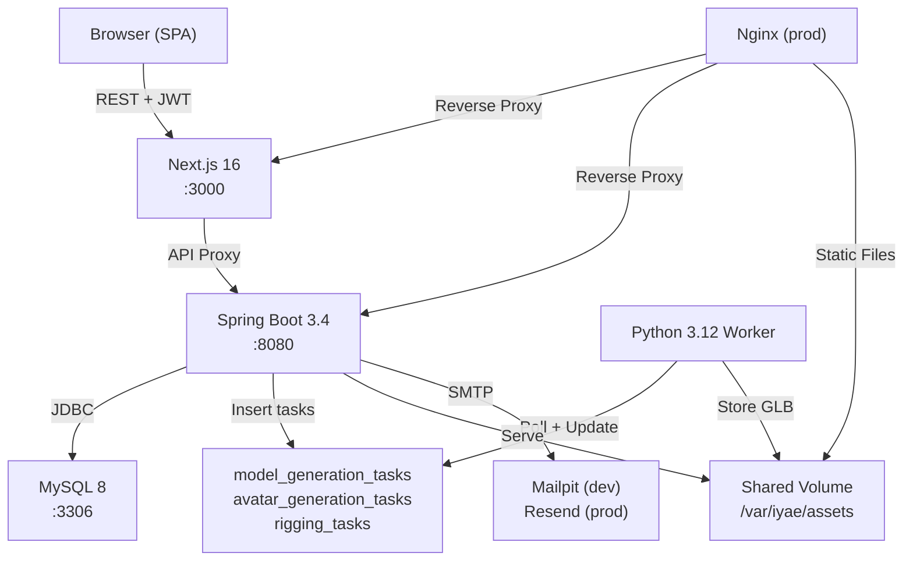

# IYAE Design Document

## Design Goals

### Goals

- Eliminate decision fatigue for Gen Z / young millennial shoppers through AI-guided styling
- Reduce fashion returns via 3D/AR virtual try-on with accurate body-aware fitting
- Empower independent designers with a self-service marketplace and promotion tools
- Build community engagement through social features (posts, follows, likes)

### Non-Goals

- No real-time multi-user collaboration or live shopping sessions
- No inventory/warehouse management (designers handle fulfillment)
- No recommendation engine beyond AI chat — no collaborative filtering or ML pipelines
- No mobile native apps (web-first, responsive SPA)

## Architecture

### Service Topology



### Key Design Decisions

| Decision | Rationale |
|----------|-----------|
| All pages `"use client"` (no RSC) | Simplifies state management; 3D viewers and animation require client-side rendering |
| MySQL task tables as integration point | Decouples server and worker without introducing a message broker; worker polls for tasks |
| Flyway migrations only (`ddl-auto: validate`) | Explicit schema control; prevents Hibernate from auto-altering production tables |
| JWT auth with secure token hashing | SHA-256 hashed tokens for email verification and password reset prevent DB-leak token reuse |
| Login returns 400 (not 401) | Constant-time response prevents username enumeration attacks |
| Forgot-password always returns 200 | Prevents account enumeration via timing or response differences |
| Demo items use negative IDs | Clearly separates client-side demo data from real database records |
| `MATERIALIZED` internal status | Worker marks tasks as MATERIALIZED; API maps to READY externally to hide implementation detail |
| Stale task reclamation (12 poll cycles) | Automatically recovers from worker crashes without manual intervention |
| Cart unique key `(cart_id, product_id, selected_size)` | Allows same product in multiple sizes in one cart |

### AI Provider Architecture

```
AIProvider (interface)
├── MockAIProvider      — deterministic responses for dev/test
├── ClaudeProvider      — Anthropic Claude API
├── DeepSeekProvider    — DeepSeek API
└── MiniMaxProvider     — MiniMax API

AIProviderFactory
├── getProvider()       — returns configured implementation
├── getProviderName()   — for health endpoint
└── healthCheck()       — for /api/health/ai
```

The `[GENERATE_OUTFIT]...[/GENERATE_OUTFIT]` protocol in `ChatService` bridges conversational AI and outfit generation — the AI response contains structured outfit data that triggers product matching.

### 3D Pipeline

```
User Request ──▶ Server creates task ──▶ MySQL task table
                                              │
Worker polls ◀────────────────────────────────┘
     │
     ├── Model Generation (Tripo3D / Meshy / Stub)
     │     └── GLB validation (header, triangles, bbox, NaN)
     │
     ├── Avatar Generation (SMPL-X / Stub)
     │     └── Body measurements → mesh → GLB
     │
     └── Garment Rigging (Python weight transfer / Blender / Mock)
           ├── Scale normalization (slot-based: TOP/BOTTOM/DRESS)
           ├── Mesh preflight (degenerate faces, manifold check)
           ├── Weight transfer (surface match → inpainting → prune/normalize)
           └── Skinned GLB output (joint hierarchy, inverse bind matrices)
```

### Security Measures

- **Authentication**: JWT with HS256, secure token hashing (SHA-256) for email verification and password reset
- **Rate limiting**: Per-IP with X-Forwarded-For proxy support
- **Input validation**: Jakarta Bean Validation at controller layer, ownership checks in service layer
- **CORS**: Configurable origins via `CORS_ORIGINS` env var
- **CSP**: Content Security Policy headers via Next.js middleware with environment-aware `script-src`
- **Error handling**: `GlobalExceptionHandler` prevents sensitive data leakage in error responses
- **File upload**: JPEG/PNG/WebP validation, atomic writes

## Technology Choices

| Layer | Technology | Rationale |
|-------|------------|-----------|
| Frontend | Next.js 16, TypeScript | App router, strong typing, large ecosystem |
| UI Components | shadcn/ui | Accessible primitives, customizable, no vendor lock-in |
| 3D Rendering | Three.js (via React Three Fiber) | Browser-native 3D, GLB/glTF support |
| Backend API | Spring Boot 3.4, Java 22 | Mature ecosystem, strong typing, excellent testing support |
| Database | MySQL 8 | Reliable RDBMS, Flyway migration support |
| Migrations | Flyway | Version-controlled, repeatable schema management |
| Worker | Python 3.12 | Rich 3D/ML ecosystem (trimesh, numpy, SMPL-X) |
| Email (dev) | Mailpit | Local SMTP capture for development |
| Email (prod) | Resend + SMTP fallback | Modern API with reliable fallback |
| Payments | Stripe Checkout | Industry standard, webhook-driven fulfillment |
| Containerization | Docker Compose | Simple multi-service orchestration |
| Production Proxy | Nginx + Certbot | SSL termination, static asset serving, security headers |

## Known Limitations

- **No WebSocket support** — AI chat uses request/response, not streaming
- **Single worker instance** — No horizontal scaling for 3D generation (task queue prevents conflicts but doesn't distribute load)
- **Client-side only rendering** — No SSR/SSG; initial load depends on client JavaScript
- **LocalStorage demo data** — Community features fall back to localStorage for unauthenticated users; not synced across devices

## Change History

| Date | Change |
|------|--------|
| 2026-06-19 | Initial design document |
